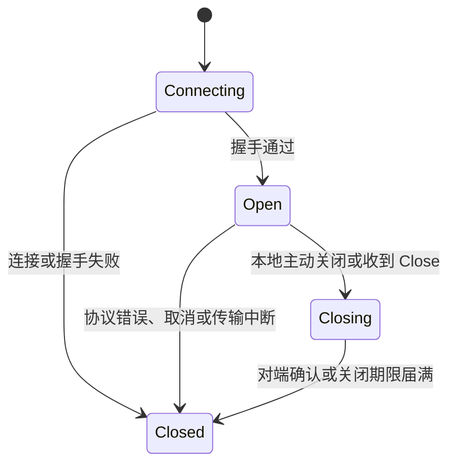

# rs-websocket 详细设计文档

> 版本：首版设计；日期：2026-10-11；状态：首版实现。本文记录目标设计与本次实现结果。

## 1. 设计依据与决策

`qubit-http` 当前通过 `reqwest::Client` 执行请求，公开 `HttpResponse` 的成功状态路径不接纳 WebSocket 握手的 `101 Switching Protocols`；SSE 仍属于 HTTP 响应流。`qubit-web` 的 WebSocket 代码面向 Axum 服务端升级，`WsUpgradePolicy` 和 `WsSession` 绑定服务端容量与停服上下文。客户端应独立建模连接与会话，但可借鉴其有限队列、读写生命周期和脱敏原则。

首版以 Tokio 和 `tokio-tungstenite`/`tungstenite` 作为协议实现底座，不自行编写握手、掩码、分片和控制帧解析器。实现时应选与 `qubit-web` 依赖兼容的版本并以锁文件固定；当前 `qubit-web` 使用 `tungstenite 0.29`，版本升级需重新运行互通测试。`wss://` 使用 rustls 及可信根证书。传输库直接依赖协议底座，不通过 `qubit-http` 的 `execute` 建立升级连接，避免把 HTTP 成功状态、重试和响应体契约改造成会话契约。

RFC 6455 是首版协议依据；`permessage-deflate`（RFC 7692）和 HTTP/2 WebSocket（RFC 8441）不在首版。握手失败、重定向、证书错误均不得隐式降级为明文连接。

## 2. 包结构与依赖方向

```text
qubit-websocket
├── client/       WsClient, WsClientBuilder, 握手构造与连接超时
├── options/      WsClientOptions, WsSessionLimits, 参数校验
├── session/      WsSession, 入站接收、出站队列、关闭协调
├── error/        WsError, WsErrorKind, WsSendError
└── internal/     读写任务、容量许可、脱敏诊断
```

`client` 只创建会话；`session` 负责连接建立后的协议 I/O；`options` 不持有活动 socket；`error` 不暴露包含凭据的底层 `Debug` 文本。`qubit-redact` 可作为 URL/请求头诊断的脱敏实现，应用消息默认不记录。`qubit-web` 只用于互通测试，不作为生产依赖。

## 3. 拟议公开 API

以下签名表达调用关系，最终实现允许在保持语义时调整名称和所有权：

```rust
pub struct WsClientBuilder { /* 配置快照 */ }
pub struct WsClient { /* 可克隆的连接配置 */ }
pub struct WsClientOptions { /* TLS、超时、请求头、限额 */ }
pub struct WsSession { /* 单条已建立连接 */ }
pub enum WsMessage { Text(String), Binary(bytes::Bytes) }
pub enum WsSendError { Backpressure, Closed, MessageTooLarge }
pub enum WsErrorKind { InvalidConfig, InvalidUrl, Connect, Tls, Handshake,
    Protocol, FrameTooLarge, MessageTooLarge, Timeout, Cancelled, Closed }

impl WsClient {
    pub fn builder() -> WsClientBuilder;
    pub async fn connect(&self, url: &str) -> Result<WsSession, WsError>;
}
impl WsSession {
    pub async fn receive(&mut self) -> Option<Result<WsMessage, WsError>>;
    pub fn try_send(&self, message: WsMessage) -> Result<(), WsSendError>;
    pub async fn send(&self, message: WsMessage) -> Result<(), WsSendError>;
    pub async fn close(&mut self) -> Result<(), WsError>;
}
```

`WsClientBuilder` 消耗自身完成 `build`，并验证配置。认证材料通过客户端级或连接级请求头提供；需要轮换 token 的调用方应在每次连接前提供新快照，不能依赖首版自动重连。握手返回的响应元数据和协商子协议应可从会话只读查询；不要将整个未脱敏响应对象直接放入 `Debug`。`receive` 为单消费者；发送句柄可克隆并共享同一有界队列。若要让接收者与发送者分属任务，可在实现中提供显式 `split`，不得为了便利复制连接。

首版实现从 crate 根导出 `WsSession`、`WsSender`，并提供只读的 `response_status_code()` 与 `selected_subprotocol()`。由于握手只在校验通过的 HTTP 101 响应后创建会话，状态码查询当前返回 101；不会保存或暴露未经筛选的响应头。

## 4. 配置及默认预算

以下值为首版设计目标，实施时应在测试中固定，并允许在验证安全范围内显式覆盖：

| 项目 | 默认值 | 边界与含义 |
| --- | --- | --- |
| TCP 连接超时 | 10 秒 | 只覆盖建立 TCP 连接。 |
| TLS 与 HTTP 握手总期限 | 10 秒 | 从 TCP 成功至握手校验完成；不覆盖整个会话。 |
| 最大帧载荷 | 1 MiB | 底层协议解析前限制。 |
| 最大重组消息 | 4 MiB | 文本与二进制均适用，包含分片重组后的内容。 |
| 入站消息队列 | 64 条、4 MiB | 两种限额同时成立；无容量时读任务等待有限期限后以 `1013` 关闭。 |
| 出站消息队列 | 64 条、4 MiB | 两种限额同时成立；`try_send` 立即返回背压。 |
| 收发无进展期限 | 30 秒 | 只针对实际读写或交付受阻；不把正常静默连接视为失败。 |
| 关闭等待期限 | 5 秒 | 等待对端 Close 与读写任务退出；超时则释放底层连接。 |

所有大小和时长必须大于零；消息大小不可超过队列字节上限。容量按实际 UTF-8/二进制字节数计，控制帧使用独立的保留通道或写入优先级，不能被应用消息塞满而无法关闭。若底层 `tungstenite` 还维护写缓冲，须将其上界纳入同一内存预算，不能只限制应用队列。

## 5. 连接建立与安全

1. 解析 URL，仅接受 `ws`/`wss`；拒绝 URL 中用户名、密码和 fragment。保留 path/query 用于握手，但日志按脱敏策略处理。
2. 为每次连接构建新握手请求。合并默认头与连接级头时，协议保留头（`Host`、`Connection`、`Upgrade`、`Sec-WebSocket-*`）由协议底座生成或受控设置，不允许调用方覆盖其关键语义。子协议列表须去重并验证 token 格式。
3. 使用直接 TCP 连接。`wss` 执行可信根验证、主机名验证和 SNI；不得提供默认跳过验证的模式。首版不跟随 `3xx`，不跨源转发 Authorization/Cookie。
4. 校验 `101` 及协议要求的响应头；服务器若返回未提议的子协议或多个互斥子协议则拒绝。保存已协商子协议及安全筛选后的响应元数据。
5. 握手成功才创建 `WsSession`，启动读写任务并交出调用方句柄。建立任一步失败都释放 socket 和临时任务。

Ping/Pong、Close、客户端掩码和分片校验由协议底座处理。读任务必须持续 poll 流，不能要求业务调用方恰好及时调用 `receive` 才能回应控制帧。客户端若需要主动探活，后续应提供可配置 Ping 间隔与 Pong 截止时间；首版不把一般业务空闲误判为断线。若底座自动 Pong 需要写侧 flush，读写协调必须确保它能及时发出。

## 6. 会话状态与数据流



读任务将文本和二进制消息送入受消息数和字节数双重约束的入站队列。队列满时暂停继续读取，进入有界无进展计时；期限届满时关闭，避免服务端无限积压。写任务从有界出站队列发送，并为 Close/Pong 保留优先级。`try_send` 只确认入队；`send` 等待队列容量，也只确认入队。两者都不能作为网络交付或业务 ACK。发送失败、对端关闭和取消必须原子地关闭队列并唤醒全部等待者。

应用收到的 `WsMessage` 只包括数据消息；Close 信息通过会话终态或结构化错误查询，Ping/Pong 不混入业务数据。`receive` 在正常关闭且队列耗尽后返回 `None`，异常中断先返回一次错误，再返回 `None`。若对端先发送 Close，停止接纳新业务消息，回复 Close 并在期限内退出。`close` 可重复调用；重复调用观察相同终态，不重复发送 Close。

最后一个会话控制句柄被丢弃时，队列关闭并通知驱动发起 Close；驱动在关闭期限内尝试完成握手，然后退出并释放连接。`Drop` 立即返回，不等待握手，也不保证对端已确认关闭。调用方需要确认关闭完成时应显式调用 `close().await`。后台任务不得仅因应用没有调用 `receive` 而永久持有会话。

## 7. 错误、取消与日志

`WsError` 提供稳定的 `kind()` 和经过脱敏的上下文；`source()` 保留底层错误供主动诊断，但默认 `Display`、`Debug` 和 tracing 不能递归打印可能含凭据的源文本。握手拒绝可保留状态码与有限的安全元数据，不默认读取或记录服务端响应体。连接超时、TLS 错误、握手拒绝、协议违规、资源超限、取消、正常关闭和异常断开需可区分。

连接阶段取消应立即中止 TCP/TLS/握手，并释放资源；会话阶段取消走同一关闭协调路径。普通 `qubit-http` 重试策略不适用：连接失败可由调用方显式重试，已发业务消息之后断线无法从传输层判断对端是否处理。未来重连 API 必须把“建立新连接”和“业务恢复”分开。

## 8. 测试与验证

| 层次 | 重点 |
| --- | --- |
| 参数单测 | 零值、大小关系、非法 URL、保留头、子协议格式、脱敏输出。 |
| 本地协议集成 | WS/WSS、认证拒绝、非法升级响应、错误子协议、证书失败、文本/二进制、分片、Ping/Pong/Close。 |
| 资源与并发 | 双向同时收发、队列满时的 `try_send`/`send`、入站不消费、取消与 Close 竞争、等待者唤醒、任务退出。 |
| 跨仓库互通 | 启动 `qubit-web` 的 `ws` 路由，验证身份头、Origin、消息限额、服务器主动关闭及停服。 |

集成测试只使用本地监听地址和测试证书，不依赖公网服务。WSS 测试显式装入测试根证书，不关闭证书验证。使用 Tokio 暂停时间或短可控截止时间覆盖超时，测试失败时保留可诊断的状态码和错误类别。验收矩阵逐项对应 [PRD](prd.zh_CN.md) 的 P0 要求。

## 9. 首版实现记录

- 帧限额和重组消息限额分别分类。配置值相等时，底层无法确定哪一项先触发，按帧限额分类。
- crate 不依赖或调用 tracing；因此 P0-08 的 trace 脱敏测试不适用。错误的默认 `Display` 与 `Debug` 脱敏由协议、安全回归测试覆盖。
- Drop 发起有界后台 Close 流程，但不阻塞调用方；显式 `close().await` 等待对端确认和驱动退出。
- 协议握手成功后可读取 HTTP 状态码与协商子协议；其余响应元数据不公开。

## 10. 分阶段实现顺序

1. 定义配置、错误与握手契约，完成 WS/WSS 建连和握手测试。
2. 实现有界会话收发、控制帧、取消和关闭，并完成资源与并发测试。
3. 对接 `qubit-web` 本地服务做互通测试，补充公开 API 文档与示例，完成首版验收。
4. 在独立需求评审后处理重连、代理和压缩；这些能力不阻塞首版。

参考：[RFC 6455](https://www.rfc-editor.org/rfc/rfc6455)、[tokio-tungstenite 文档](https://docs.rs/tokio-tungstenite/)、[`qubit-http` 当前设计](https://github.com/qubit-ltd/rs-http/blob/main/doc/design.zh_CN.md)、[`qubit-web` 当前生命周期设计](https://github.com/qubit-ltd/rs-web/blob/main/doc/2026-10-09-rs-web-lifecycle-design.zh_CN.md)。
