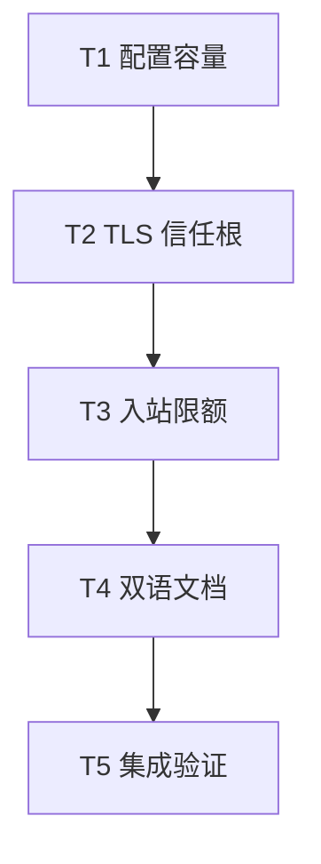

# rs-websocket 配置、TLS 与文档修复实施计划

> **面向执行者：** 按任务顺序实施，每步用复选框记录进度。设计依据：[本轮设计](design-20261013T043742422Z-8ff0520f.md)。本计划写在用户指定路径；不创建临时文档或新 Paseo workspace。

**目标：** 消除公开配置导致的连接期 panic，统一 TLS 信任根语义，明确入站限额方向，并提供中英文完整接入文档。

**架构：** `WsClientOptions` 在建客户端时完成所有可验证边界检查；TLS connector 由显式信任根模式构造；tungstenite 仅负责入站帧与消息读取限制，出站仍由现有队列预算控制。文档以公开 API 和本地互通测试为事实来源。

**技术栈：** Rust 2024、Rust 1.94、Tokio、rustls 0.23、tokio-tungstenite 0.29、webpki-roots、Cargo。

## 全局约束

- 仓库：`/data/working/qubit/rust-common/rs-websocket`；只修改本轮设计直接涉及的源码、测试、示例和文档。
- 不修改 `rs-web` 生产代码，不实现代理、压缩、自动重连、业务 ACK 或系统根证书模式。
- 用户允许破坏性 API 变更：旧的 `max_frame_bytes`、`max_message_bytes` 和 `root_certificates: Option<RootCertStore>` 字段无需兼容层。
- 生产 Rustdoc 使用英文；README 与用户指南分别维护自然的英文、简体中文版本，保持事实与错误边界一致。
- 不执行 `git add`、`git commit`、`git push`。实施前读取当前仓库适用的 `AGENTS.md` 和本环境按需 Rust/测试/Git 规则。
- 测试先写可观察行为，再修改实现；全量测试、Clippy、Rustdoc 只由任务 T5 运行，避免重复占用 Cargo target。

## 文件职责与调度图

| 任务 | 前置任务 | 最小解锁产物 | 写入集合 | 本地验证 | 集成验证归属 | 审查时机 |
| --- | --- | --- | --- | --- | --- | --- |
| T1 配置容量 | 无 | `validate()` 拒绝超限消息数 | `src/options.rs`、`tests/options_tests.rs` | `cargo test --locked --test options_tests` | T5 | 立即审查 |
| T2 TLS 信任根 | T1 | `WsTrustRoots` 三模式及 connector 可编译 | `src/options.rs`、`src/client.rs`、`src/client/handshake.rs`、`src/lib.rs`、`Cargo.toml`、`Cargo.lock`、`tests/protocol_tests.rs` | `cargo test --locked --test protocol_tests` 与 `cargo test --locked --lib client::handshake` | T5 | 立即审查 |
| T3 入站限额 | T2 | 新字段名与出站预算语义可编译 | `src/options.rs`、`src/session.rs`、`src/session/driver.rs`、`src/client/handshake.rs`、`tests/options_tests.rs`、`tests/session_tests.rs`、`tests/protocol_tests.rs`、`tests/web_interop_tests.rs`、`examples/*.rs` | `cargo test --locked --test options_tests --test session_tests --test protocol_tests --test web_interop_tests` | T5 | 立即审查 |
| T4 双语文档 | T3 | 两份 README、两份指南与历史设计提示 | `README.md`、`README.zh_CN.md`、`doc/user_guide.md`、`doc/user_guide.zh_CN.md`、`doc/design.zh_CN.md` | 本任务检查相对链接、符号和示例命令 | T5 | 批量审查 |
| T5 集成验证 | T4 | 全量门禁结果与最终 diff | 不写入源码；必要修正回到所属任务文件 | 全量门禁及 `git diff --check` | T5 | 立即审查 |

这些任务因共享 `src/options.rs`、`src/client/handshake.rs` 和最终文档事实依次解锁；没有可安全并行写入的任务。所有重型 Cargo 命令共用本仓库 `target` 资源组，按表顺序执行。



### T1：在建客户端时拒绝消息数超限

**接口：** `WsClientOptions::validate() -> Result<(), WsError>`；`WsClientBuilder::build()` 继续调用它，不改返回类型。

- [x] 在 `tests/options_tests.rs` 增加 `inbound_messages` 与 `outbound_messages` 分别为 `tokio::sync::Semaphore::MAX_PERMITS + 1` 的用例；断言 `validate()` 及 `WsClient::builder().limits(limits).build()` 返回 `WsErrorKind::InvalidConfig`。再验证二者取 `MAX_PERMITS` 时 `validate()` 返回 `Ok(())`，不建立连接。
- [x] 运行 `cargo test --locked --test options_tests`，确认新用例先失败，且失败原因是超限配置被错误接受。
- [x] 在 `src/options.rs` 的 `semaphore_limits_fit` 中加入两项消息数检查：

  ```rust
  limits.inbound_messages <= tokio::sync::Semaphore::MAX_PERMITS
      && limits.outbound_messages <= tokio::sync::Semaphore::MAX_PERMITS
  ```

- [x] 重跑 `cargo test --locked --test options_tests`，确认容量测试通过；检查 `src/session/queue.rs` 的内部断言仍在，避免内部调用绕过不变量。

### T2：实现默认、追加、独占三种 TLS 信任根模式

**输入依赖：** T1 的 `WsClientOptions::validate()` 已稳定。**输出接口：** `pub enum WsTrustRoots { Default, Additional(RootCertStore), Exclusive(RootCertStore) }`；`WsClientOptions::trust_roots: WsTrustRoots`；`WsClientBuilder::root_certificates` 和 `exclusive_root_certificates`。

- [ ] 先在 `src/client/handshake.rs` 的单元测试和 `tests/protocol_tests.rs` 增加失败用例：默认 trust store 含 WebPKI 根，追加模式含 WebPKI 与测试 CA，独占模式只含测试 CA；两种自定义模式均能连接由测试 CA 签发且主机名正确的本地 WSS；错误主机名及不可信 CA 仍失败。使用私有 `build_root_store(&WsTrustRoots) -> RootCertStore` 辅助函数检查集合，不访问公网。
- [ ] 运行 `cargo test --locked --test protocol_tests` 和 `cargo test --locked --lib client::handshake`，确认新增模式或断言先失败。
- [ ] 在 `src/options.rs` 定义可克隆的公开 `WsTrustRoots`，将 `WsClientOptions::root_certificates` 替换为 `trust_roots`，默认 `Default`；`Debug` 只显示模式和安全的计数，不打印证书原文。在 `src/lib.rs` 导出类型。在 `src/client.rs` 保持 `root_certificates(roots)` 并使它设置 `Additional(roots)`，新增 `exclusive_root_certificates(roots)` 设置 `Exclusive(roots)`；最后一次调用生效。为类型、变体、字段和方法补英文 Rustdoc。
- [ ] 在 `Cargo.toml` 加入与当前 rustls 兼容的直接依赖 `webpki-roots = "1"`，仅通过正常 Cargo 解析更新 `Cargo.lock`。`build_root_store` 从 `webpki_roots::TLS_SERVER_ROOTS` 建立默认集合，`Additional` 再延伸传入 store 的根，`Exclusive` 只克隆传入 store；`connect_socket` 对 `wss` 使用由此创建的 `Connector::Rustls`，保留证书链和主机名验证。不要加入 insecure verifier。
- [ ] 重跑上述两条聚焦命令；核对 `src/client/handshake.rs` 中的旧 `Option<RootCertStore>` 路径已消失，并确认 TLS 负例仍通过。

### T3：破坏性重命名入站限额并固定出站行为

**输入依赖：** T2 的公开配置和 connector。**输出接口：** `WsSessionLimits::{max_inbound_frame_bytes, max_inbound_message_bytes, inbound_messages, inbound_bytes, outbound_messages, outbound_bytes, ...}`；后四个队列字段及错误枚举保持原名。

- [ ] 先在 `tests/options_tests.rs` 增加独立预算测试：`max_inbound_message_bytes <= inbound_bytes` 时，即使 `outbound_bytes` 更小也可通过校验；`max_inbound_frame_bytes > max_inbound_message_bytes` 或 `max_inbound_message_bytes > inbound_bytes` 仍返回 `InvalidConfig`。在 `tests/session_tests.rs` 增加本地端点测试：出站 payload 超过入站帧/消息上限但不超过 `outbound_bytes` 时发送端可入队，超过 `outbound_bytes` 时 `try_send` 返回 `MessageTooLarge`。
- [ ] 运行 `cargo test --locked --test options_tests --test session_tests`，确认新测试先失败。
- [ ] 在 `src/options.rs` 将两个公开字段重命名并修改默认值、校验关系与英文 Rustdoc：

  ```rust
  let consistent = limits.max_inbound_frame_bytes <= limits.max_inbound_message_bytes
      && limits.max_inbound_message_bytes <= limits.inbound_bytes;
  ```

  `outbound_bytes` 继续约束单条出站 payload 和出站队列总 payload；不新增出站帧自动分片。
- [ ] 在 `src/session.rs`、`src/session/driver.rs`、`src/client/handshake.rs`、相关 `tests/` 与 `examples/` 将旧字段引用改为新字段，并让 tungstenite 的 `max_frame_size`、`max_message_size` 使用入站字段。保持 `max_write_buffer_size = outbound_bytes.checked_add(14)` 的溢出检查。更新错误说明，明确 `FrameTooLarge` 与 `MessageTooLarge` 的入站含义，`WsSendError::MessageTooLarge` 的出站含义。
- [ ] 运行 `cargo test --locked --test options_tests --test session_tests --test protocol_tests --test web_interop_tests`；再用 `rg -n 'max_frame_bytes|max_message_bytes' src tests examples` 确认无旧字段引用。若有测试辅助函数与服务端 `rs-web` API 同名参数，逐一判定后保留其独立命名。

### T4：补齐双语首次接入与用户指南

**输入依赖：** T3 已确定的公开 API、TLS 模式、限额方向和测试结果。**输出接口：** 两份 README 与 `doc/user_guide.md`、`doc/user_guide.zh_CN.md`；两份指南互链。

- [ ] 对照 `examples/ws_client.rs`、`examples/wss_client.rs` 和测试，分别修改 `README.md`、`README.zh_CN.md`：在能力简介后提供安装片段、需要已运行 WS/WSS 端点的前提，以及一个从 `WsClient::builder().build()` 到 `connect`、`send`、`receive`、检查终态和 `close` 的完整公开 API 片段。保留已有六徽章及 Testing/License/Contributing/Author 尾部。明确 `send` 成功仅表示入队。
- [ ] 新建两份用户指南，沿同一个服务消费事件的场景写准备、WS/WSS 连接、认证头和子协议、TLS `Default`/`Additional`/`Exclusive`、`WsSender` 并发发送、入站与出站预算、背压处理、正常关闭与错误终态、取消和应用负责的重试/恢复。每段代码写明放置位置、输入前提及可观察结果；两版都链接实际示例、API 文档、README 和另一语言指南。
- [ ] 在 `doc/design.zh_CN.md` 开头增加指向本轮设计的提示，说明旧字段和旧 TLS 描述是首版历史内容。两份 README 加迁移表：`max_frame_bytes` → `max_inbound_frame_bytes`，`max_message_bytes` → `max_inbound_message_bytes`，`root_certificates: Option<RootCertStore>` → `trust_roots: WsTrustRoots`；说明 Builder `root_certificates` 现在追加默认根，需独占信任时改用 `exclusive_root_certificates`。
- [ ] 检查所有新增相对链接确实存在、Markdown 锚点指向实际标题；用 `rg` 核对 README 和指南中的公开符号、默认值及错误名与代码一致。把可独立编译的示例保存到现有示例或 Rustdoc 测试中验证，不新增仅镜像文字的测试。

### T5：集成验证与范围复核

**输入依赖：** T1–T4 全部完成。**输出：** 可复现的门禁结果及只包含本轮范围的工作区 diff。

- [ ] 运行 `cargo fmt --all -- --check --config-path .infra/style/rustfmt.toml`。项目配置包含只在 nightly 生效的选项；若稳定版打印这些选项的警告，只以命令退出码判断检查结果。发现格式差异时只整理本轮变更文件并重检。
- [ ] 依次运行 `cargo test --locked`、`cargo clippy --locked --all-targets -- -D warnings`、`cargo doc --no-deps --locked`。确认现有 WS/WSS、握手、取消、关闭和 `qubit-web` 互通测试没有退化；记录测试数量与退出码。
- [ ] 运行 `git diff --check`、`git status --short`、`git diff --stat`，检查没有无关文件或生成产物混入。检查文档中不存在未实现承诺，并逐项对照设计文档五条验收标准。
- [ ] 若某项门禁失败，回到对应任务的最小文件集合修正并重跑失败的聚焦检查，最后重新运行受影响的全量门禁。交付时明确列出破坏性 API 迁移项和任何未解决的限制；不提交或推送。

## 设计覆盖自检

| 设计要求 | 实施任务 |
| --- | --- |
| 消息数信号量边界与无 panic 构建 | T1、T5 |
| 默认 WebPKI、追加与独占根、TLS 负例 | T2、T4、T5 |
| 入站字段方向、独立出站预算与破坏性迁移 | T3、T4、T5 |
| 中英文 README、指南、历史设计提示与链接 | T4、T5 |
| 全量测试、Clippy、rustfmt、Rustdoc、范围检查 | T5 |
