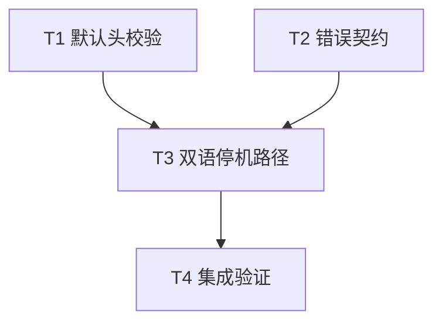

# rs-websocket 配置校验、错误契约与停机文档修复实施计划

> **面向执行者：** 按任务依赖实施本计划，以 `- [x]` 跟踪进度。设计依据：[本轮设计](design-20261013T100102963Z-5e3c91ab.md)。本文件位于用户指定的目标路径；实施不需要再次发起设计审批。

**目标：** 提前拒绝默认协议保留头，移除不会产生的错误类别，使中英文文档展示可主动停机的会话生命周期，并使用项目格式配置完成验证。

**架构：** `src/client.rs` 复用私有头校验函数，构建默认配置时与组装连接请求时执行同一规则。公开错误枚举只保留实际可返回类别；双语文档用应用提供的 Tokio `oneshot` 停机信号协调接收、显式关闭和任务回收。

**技术栈：** Rust 2024、Rust 1.94、Tokio 1.53、tokio-tungstenite 0.29、Cargo、项目 `.infra` 风格门禁。

## 全局约束

- 仓库：`/data/working/qubit/rust-common/rs-websocket`；只触及本计划列出的源码、测试和文档。用户允许移除两个公开错误变体，无需兼容层。
- 不修改 `rs-web` 生产代码，不改变 WS/WSS、TLS、队列、超时和关闭握手语义。
- 生产 Rustdoc 使用英文；中英文 README 与指南分别自然成文，保持行为、错误类别和操作步骤一致。
- 实施前核对当前工作区状态并读取适用的仓库规则；未经用户另外要求，不执行 `git add`、`git commit` 或 `git push`，不创建新的 Paseo workspace。
- 测试和编译命令共用本仓库 `target` 资源组；独立编辑可并行，重型 Cargo 命令串行执行。全量测试与文档门禁只在 T4 执行。
- 评审时已核实 `cargo fmt --all -- --check --config-path .infra/style/rustfmt.toml` 退出码为 0；不要因为无配置的 `cargo fmt` 差异批量改写全库。

## 调度图

| 任务 | 前置任务 | 最小解锁产物 | 写入集合 | 本地验证 | 集成验证归属 | 审查时机 |
| --- | --- | --- | --- | --- | --- | --- |
| T1 默认头校验 | 无；与 T2 同一并行批次 | `build()` 提前拒绝保留头，局部测试通过 | `src/client.rs`、`tests/handshake_tests.rs` | `cargo test --locked --offline --test handshake_tests` 与 `cargo test --locked --offline --lib client::tests` | T4 | 立即审查 |
| T2 错误契约 | 无；与 T1 同一并行批次 | 公开枚举移除两个空置变体，`cargo check` 通过 | `src/error.rs` | `cargo check --locked --offline --all-targets` | T4 | 立即审查 |
| T3 双语停机路径 | T1、T2 | 两份 README、两份指南和历史设计提示一致 | `README.md`、`README.zh_CN.md`、`doc/user_guide.md`、`doc/user_guide.zh_CN.md`、`doc/design.zh_CN.md` | 文档符号、链接与停机示例的聚焦检查 | T4 | 批量审查 |
| T4 集成验证 | T3 | 门禁输出、迁移核对和最终 diff | 原则上不写源码；失败时回到所属任务文件修正 | 项目风格、完整测试、Rustdoc、Clippy、范围检查 | T4 | 立即审查 |

T1 与 T2 的写入集合互不相交，可同时编辑；它们的 Cargo 验证因共用 `target` 串行运行。T3 必须在公开错误集合和头校验行为稳定后写作。没有要求执行者启动子智能体。



### T1：在构建客户端时拒绝默认保留头

**文件：** `src/client.rs`、`tests/handshake_tests.rs`。

**接口：** 保留 `WsClientBuilder::build(self) -> Result<WsClient, WsError>` 和 `WsClient::connect_with(&self, &str, HeaderMap)`；新增私有 `validate_user_headers(&HeaderMap) -> Result<(), WsError>`，供构建和 `apply_user_headers` 复用。

- [x] 在 `src/client.rs` 的单元测试加入默认头拒绝用例。分别将 `host`、`connection`、`upgrade`、`sec-websocket-protocol` 放入 `HeaderMap`，调用 `.headers(headers).build()`，用 `match` 取得错误并断言 `WsErrorKind::InvalidConfig`；再以 `authorization` 验证普通头仍可构建。不要使用要求 `WsClient: Debug` 的 `unwrap_err()`。
- [x] 运行 `cargo test --locked --offline --lib client::tests`，确认新增保留头用例先因 `build()` 错误接受配置而失败。
- [x] 在 `src/client.rs` 的 `is_reserved_header` 附近加入以下共用逻辑，并让 `apply_user_headers` 先校验、再插入：

  ```rust
  fn validate_user_headers(headers: &HeaderMap) -> Result<(), WsError> {
      if headers.keys().any(is_reserved_header) {
          return Err(WsError::new(WsErrorKind::InvalidConfig));
      }
      Ok(())
  }
  ```

- [x] 在 `WsClientBuilder::build()` 的现有数值与子协议校验后调用 `validate_user_headers(&self.options.headers)?`；不改变 `WsClientOptions::validate()` 只检查数值约束的职责。`apply_user_headers` 删除循环内重复的保留头分支，保留默认头先插入、连接级头后覆盖的顺序。
- [x] 在 `tests/handshake_tests.rs` 补连接级保留头用例：先构建合法客户端，给 `connect_with("ws://127.0.0.1:1/", headers)` 传入 `Sec-WebSocket-Key`，断言返回 `InvalidConfig` 而非连接错误；这样验证拒绝发生在 TCP 前。检查现有普通头覆盖测试仍通过。
- [x] 依次运行 `cargo test --locked --offline --lib client::tests` 和 `cargo test --locked --offline --test handshake_tests`；预期全部通过。若第二项无法稳定区分网络阶段，可改为本地请求组装单元测试，但必须仍证明连接级头在建连前拒绝。

### T2：移除不会出现的 `WsErrorKind` 结果

**文件：** `src/error.rs`。

**接口：** 删除 `WsErrorKind::Cancelled`、`WsErrorKind::Closed`；保留 `WsSendError::Closed` 和其发送队列行为。

- [x] 用 `rg -n 'WsErrorKind::(Cancelled|Closed)' src tests examples` 复核两者没有构造或匹配路径；检查 `WsErrorKind::Internal` 的现有驱动路径，不误删实际使用的变体。
- [x] 在 `src/error.rs` 删除这两个变体及其注释；保持其他变体与错误格式化实现不变。`WsSendError::Closed` 及其 Rustdoc 原样保留。
- [x] 运行 `cargo check --locked --offline --all-targets`；预期通过。若编译暴露已有引用，逐一检查是否应迁移为 `WsSendError::Closed` 或实际产生的终态类别，不为了过编译引入新的占位变体。

### T3：补齐中英文服务停机接入路径

**文件：** `README.md`、`README.zh_CN.md`、`doc/user_guide.md`、`doc/user_guide.zh_CN.md`、`doc/design.zh_CN.md`。

**输入依赖：** T1 的默认头行为、T2 的公开错误枚举。

- [x] 在两份 README 的 Tokio 安装片段增加 `sync` 特性。保留六枚徽章、已有项目定位与 Testing/License/Contributing/Author 尾部；在首次接入片段中将函数签名改为接收 `tokio::sync::oneshot::Receiver<()>`，让接收循环同时等待停机与 `receive()`。以下控制流是两版的共同技术事实，业务输出文字可分别写作：

  ```rust
  async fn consume_events(
      mut shutdown: tokio::sync::oneshot::Receiver<()>,
  ) -> Result<(), Box<dyn std::error::Error>> {
      let client = WsClient::builder().build()?;
      let mut session = client.connect("wss://events.example.com/ws").await?;
      session.send(WsMessage::Text("subscribe:job-42".into()))
          .await
          .map_err(|error| std::io::Error::other(format!("{error:?}")))?;
      loop {
          let next = tokio::select! {
              _ = &mut shutdown => break,
              next = session.receive() => next,
          };
          match next {
              Some(Ok(WsMessage::Text(event))) => println!("event: {event}"),
              Some(Ok(WsMessage::Binary(bytes))) => println!("binary: {} bytes", bytes.len()),
              Some(Err(error)) => { eprintln!("session: {:?}", error.kind()); break; }
              None => break,
          }
      }
      let close_result = session.close().await;
      println!("terminal: {:?}", session.termination());
      close_result?;
      Ok(())
  }
  ```

- [x] 在两份 README 说明应用如何创建 `oneshot::channel()`、将接收端交给 worker、在停机时 `send(())` 并等待 worker 完成；说明发送端意外释放也会让接收端结束。保留端点和订阅格式属于应用的说明，不承诺 `send()` 代表业务确认。
- [x] 在两份用户指南的基础 worker 代码中使 `subscribe`、`receive_events` 与停机接收端签名一致；提供启动方的完整代码或已编译示例引用，说明任务入口、通道所有权、停机发送和任务回收。进阶章节说明先停生产者、再发停机信号、随后等待有界 `close()`；分别解释对端正常关闭、终态错误和本地主动停机时的结果。
- [x] 从两份指南的 `WsErrorKind` 列表移除 `Cancelled` 与 `Closed`，明确 future 取消没有错误返回，`WsSendError::Closed` 仍表示发送端已关闭。两份 README 添加简短迁移提示：删除的 `WsErrorKind` 变体没有运行时生成路径，发送关闭错误继续匹配 `WsSendError::Closed`。
- [x] 在 `doc/design.zh_CN.md` 首段加入指向本设计文档的链接，标明旧文档是首版历史设计、当前错误契约以本设计及源码为准；不重写历史设计正文。
- [x] 检查 README、指南与示例中的公开类型、依赖特性、默认值、错误名和相对链接；用同一临时验证片段编译两版 README 的 Rust 代码，或将等效完整代码放入现有 Rustdoc/示例再执行 `cargo test --doc --locked --offline`。文档检查不要求访问真实公网端点。

### T4：执行集成门禁并核对改动范围

**输入依赖：** T1、T2、T3 全部完成。**输出：** 可复现的门禁结果与迁移说明。

- [x] 运行 `cargo fmt --all -- --check --config-path .infra/style/rustfmt.toml`。若本轮源码需要整理，只按项目方式执行 `./.infra/bin/align-ci.sh`，随后重新检查被改文件和最终 diff；不要运行无配置的全库格式化。
- [x] 运行 `./.infra/bin/style-check.sh`、`cargo test --locked --offline`、`cargo clippy --locked --offline --all-targets -- -D warnings`、`cargo doc --locked --offline --no-deps`。预期命令全部退出 0；若项目风格门禁与独立命令有差异，以实际输出定位并修正相关文件。
- [x] 运行 `rg -n 'WsErrorKind::(Cancelled|Closed)' src tests examples README.md README.zh_CN.md doc/user_guide.md doc/user_guide.zh_CN.md` 检查移除的枚举引用没有残留；另查两份指南的错误列表，确认不再承诺 `Cancelled` 或 `WsErrorKind::Closed`。单独核对 `WsSendError::Closed` 仍在源码和指南中，并检查双语停机步骤及 README 安装特性一致。
- [x] 运行 `git diff --check`、`git status --short`、`git diff --stat`，核对只包含本轮源码、测试和文档范围；如存在预先的用户改动，保留并区分其来源。交付记录实际命令、退出码、测试数量、破坏性变更及未验证项；不执行提交或推送。

## 设计覆盖自检

| 设计要求 | 任务 |
| --- | --- |
| 默认头在构建期拒绝、连接级头在网络前拒绝 | T1、T4 |
| 移除未使用的 `WsErrorKind` 变体并保留发送错误 | T2、T3、T4 |
| 双语 README 与指南的停机信号、主动关闭、结果检查、迁移说明 | T3、T4 |
| 项目配置化格式检查和完整测试门禁 | T4 |


## 实施结果（2026-10-13）

- T1、T2、T3 与 T4 验收项已完成；实现分别记录在 `fix(client): validate reserved headers during build`、`fix(error): remove unreachable session error kinds`、`docs(shutdown): document worker cancellation lifecycle` 三个实现提交中；独立复审补充的启动调用记录在 `docs(shutdown): connect worker startup examples`。
- `.infra/bin/align-ci.sh`、`.infra/bin/ci-check.sh`、`cargo fmt --all -- --check --config-path .infra/style/rustfmt.toml`、`.infra/bin/style-check.sh`、`cargo test --locked --offline`、`cargo clippy --locked --offline --all-targets -- -D warnings`、`cargo doc --locked --offline --no-deps` 均以退出码 0 完成。
- `cargo test --locked --offline`：29 个单元测试、46 个集成测试、1 个 doctest 通过。CI 覆盖率：functions 96.89%、lines 93.72%、regions 92.53%，均超过仓库门槛。
- README 与指南中的停机片段（含服务启动方对 worker 的闭合调用）已放入一次性临时 crate 执行 `cargo check --offline`，退出码 0；临时验证目录在最终清理阶段移除。
- 删除 `WsErrorKind::Cancelled` 和 `WsErrorKind::Closed` 是有意的公开 API 破坏性变更；保留 `WsSendError::Closed`。最终独立审查发现并补充了 README/指南中 worker helper 的实际启动调用；更新后的片段重新编译通过。复审完成后没有未验证项。
