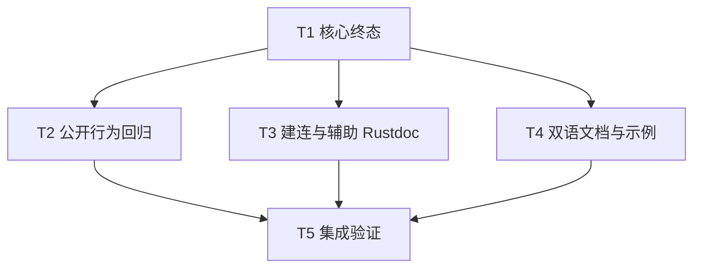

# rs-websocket 会话终态与错误契约修复实施计划

> **面向执行者：** 依据[本轮设计](design-20261013T160128707Z-ced40f60.md)逐项实施，以 `- [ ]` 跟踪进度。用户已批准这些改进和必要的破坏性变更；不再发起设计审批。本文直接保存在用户指定的目标路径。

**目标：** 修复对端 Close 回复失败被记为正常结束的问题，保留错误关闭码供应用判断，校准传输错误分类和 Rustdoc，并同步中英文使用文档。

**架构：** 驱动用唯一的终态合并函数处理读写结果，公开 `Closed { code }` 表示协议关闭完成，`Error { kind }` 表示关闭或传输失败。`Connect` 重命名为覆盖建连及运行期 I/O 的 `Transport`，任务 join 故障归 `Internal`。应用自行解释对端关闭码。

**技术栈：** Rust 2024、Rust 1.94、Tokio、tokio-tungstenite 0.29、Cargo、项目 `.infra` 门禁。

## 全局约束

- 仓库为 `/data/working/qubit/rust-common/rs-websocket`；先检查项目 `AGENTS.md`、Git 状态及用户已有改动。只修改本计划列出的相关文件，不创建新的 Paseo workspace。
- 用户允许 `Normal -> Closed`、`Connect -> Transport` 的破坏性变更；不要保留弃用别名。`WsSendError`、队列限额、TLS 和握手范围保持现有语义。
- 生产 Rustdoc 使用英文；两份 README 与两份指南分别自然写作，关闭码、错误类别、应用决策和示例语义一致。
- 未经用户另外要求，不执行 `git add`、`git commit` 或 `git push`。实施计划中的“解锁产物”指本地验证通过的文件，无须提交。
- 所有 Cargo 命令共用本仓库 `target` 资源组，重型验证串行执行。格式检查使用 `cargo fmt --all -- --check --config-path .infra/style/rustfmt.toml`；无配置的 rustfmt 差异不是本轮改动依据。
- 单个聚焦测试先红后绿。纯函数测试须与受控写侧失败测试一起覆盖驱动路径；不要使用依赖 TCP 缓冲区或任意休眠的脆弱测试。

## 文件职责

| 文件 | 职责 |
| --- | --- |
| `src/error.rs` | 公开 `WsTermination::Closed` 与 `WsErrorKind::Transport`，更新 Rustdoc |
| `src/session/driver.rs` | 汇总读写终态、处理 join 错误、补驱动测试及辅助函数 Rustdoc |
| `src/session.rs` | 迁移终态匹配和生命周期 Rustdoc |
| `src/client/handshake.rs`、`src/client.rs`、`src/options.rs`、`src/message.rs` | TCP 错误类别迁移，补握手辅助函数及核心公开类型 Rustdoc |
| `tests/session_tests.rs`、`tests/web_interop_tests.rs`、`tests/options_tests.rs` | 对端关闭码、关闭重试、错误类别回归 |
| `src/lib.rs`、`README.md`、`README.zh_CN.md`、`doc/user_guide.md`、`doc/user_guide.zh_CN.md`、`doc/design.zh_CN.md` | 公开示例、双语使用路径、历史设计入口 |

两个命令行示例目前没有匹配受影响的枚举，实施时只核查编译，不因本计划改写其收发流程。

## 调度图

| 任务 | 前置任务 | 最小解锁产物 | 写入集合 | 本地验证 | 集成验证归属 | 审查时机 |
| --- | --- | --- | --- | --- | --- | --- |
| T1 核心终态 | 无 | 新枚举与读写合并路径通过聚焦测试 | `src/error.rs`、`src/session/driver.rs`、`src/session.rs` | `cargo test --locked --offline --lib session::driver::tests` | T5 | 立即审查 |
| T2 公开行为回归 | T1 | 对端关闭码与关闭错误的外部断言通过 | `tests/session_tests.rs`、`tests/web_interop_tests.rs`、`tests/options_tests.rs` | 三个 `--test` 聚焦命令，顺序执行 | T5 | 立即审查 |
| T3 建连与辅助 Rustdoc | T1；与 T2 同一并行批次 | 建连错误分类、握手 helper 与核心类型文档一致 | `src/client/handshake.rs`、`src/client.rs`、`src/options.rs`、`src/message.rs` | `cargo test --locked --offline --lib client::handshake::tests` | T5 | 批量审查 |
| T4 双语文档与示例 | T1；与 T2、T3 同一并行批次 | 两种语言及 crate 示例反映新契约 | `src/lib.rs`、两份 README、两份用户指南、`doc/design.zh_CN.md` | 文档链接/符号核对、`cargo test --doc --locked --offline` | T5 | 批量审查 |
| T5 集成验证 | T2、T3、T4 | 门禁结果与最终变更范围 | 原则上不写文件；失败退回所属任务 | 格式、风格、全量测试、Clippy、Rustdoc、diff | T5 | 立即审查 |

T2、T3、T4 的写入集合互不相交，T1 验证通过后可同批编辑；共享 `target` 的 Cargo 命令仍串行。执行者可自行安排并行工作，但不要求启动子智能体。



### T1：修复核心终态

**文件：** `src/error.rs`、`src/session/driver.rs`、`src/session.rs`。

**接口：** `WsTermination::Closed { code: Option<u16> }`、`WsErrorKind::Transport`；私有 `resolve_termination(ReadResult, Option<WsErrorKind>) -> WsTermination` 与 `complete_after_reader(ReadResult, &mut JoinHandle<Option<WsErrorKind>>, Duration) -> WsTermination`。后者封装读侧先结束后的有界写侧等待及 abort。

- [x] 在 `src/session/driver.rs` 先写驱动失败测试：用 `tokio::spawn(async { Some(WsErrorKind::Transport) })` 作为可控写侧，传 `ReadResult::Closed(Some(1000))` 给 `complete_after_reader`，断言 `Error { kind: Transport }`；再用永不完成的写任务和短 `close_timeout` 断言 `Error { kind: Timeout }` 且任务已 abort。增加 `resolve_termination` 表格测试覆盖 `1000`、`1009`、`None`、读侧错误、本地关闭及写侧错误。执行 `cargo test --locked --offline --lib session::driver::tests`，确认新行为先失败。
- [x] 在 `src/error.rs` 将 `Normal` 改为 `Closed`、`Connect` 改为 `Transport`。给 `Closed.code` 写明“对端提供的原始关闭码；`1009` 或缺失状态码不代表业务成功”，给 `Transport` 写明连接及运行期 I/O。保持 `Error { kind }` 与其他公开变体不变。
- [x] 为 `WsTermination`、`WsErrorKind`、`WsSession`、`WsSender` 的类型级英文 Rustdoc 补可经 `qubit_websocket::` 公共路径编译的 `# Examples`；示例构建客户端、连接本地占位端点（使用 `no_run`）、匹配 `Closed`/`Error`，不把队列入队当成交付确认。类型级说明解释关闭码与所有权，避免只复述字段。
- [x] 在 `src/session/driver.rs` 落实合并表；核心逻辑可按以下形状编写，并在 `run` 的读侧先结束分支调用有界等待函数：

  ```rust
  fn resolve_termination(read: ReadResult, write: Option<WsErrorKind>) -> WsTermination {
      match (read, write) {
          (ReadResult::Error(kind), _) => WsTermination::Error { kind },
          (ReadResult::Closed(code), None) => WsTermination::Closed { code },
          (ReadResult::LocalClose, None) => WsTermination::Closed { code: None },
          (_, Some(kind)) => WsTermination::Error { kind },
      }
  }
  ```

  `JoinError` 映射为 `Internal`；有界等待超时先 `writer.abort()` 再传 `Some(Timeout)`。写侧先结束分支也用同一个 `resolve_termination(ReadResult::LocalClose, result)`，不可继续使用原来的直接 `match`。保留 `run` 原有队列关闭、终态只写一次、通知顺序。
- [x] 用现有 `ControlledSink` 的可控 flush 行为给 `timeout_flush` 补错误/超时测试；分别令 `poll_flush` 返回 `tungstenite::Error::Io(...)` 和永久 Pending，确认前者映射 `Transport`、后者映射 `Timeout`。与上一条的 `complete_after_reader` 测试共同覆盖“实际写侧结果进入终态”；不要仅留下纯函数测试。
- [x] 在 `src/session.rs` 将所有 `Normal` 匹配迁移为 `Closed`，保留 `receive()` 单次错误交付和 `close()` 重复调用语义；给这两个方法及 `termination()` 补英文错误、关闭码、超时说明。`termination_error` 对 `Closed` 返回 `None`，对 `Error` 返回 `Some(kind)`。
- [x] 将 `src/session/driver.rs` 中原来以 `Connect` 表示任务 join 失败的分支改为 `Internal`，底层运行期 I/O 改为 `Transport`；检查 `map_error` 对 `Protocol`、容量和 `Timeout` 的既有分类不倒退。补 `ReadResult`、终态合并及本轮触及关闭 helper 的英文 Rustdoc。
- [x] 运行 `cargo test --locked --offline --lib session::driver::tests` 与 `cargo test --locked --offline --lib session::tests`，预期相关测试通过；若旧断言因枚举重命名不能编译，在本任务文件内同步迁移。立即复核终态优先级和 abort 后资源释放。

### T2：固定公开行为与错误分类

**文件：** `tests/session_tests.rs`、`tests/web_interop_tests.rs`、`tests/options_tests.rs`。

**输入依赖：** T1 的 `Closed`、`Transport`、驱动终态合并逻辑。

- [x] 在 `tests/session_tests.rs` 将 `peer_first_close_is_normal_and_repeated_close_is_stable` 的断言改为 `WsTermination::Closed { code: Some(1000) }`，将取消后重试关闭等 `Normal` 匹配改为 `Closed`；保持关闭超时必须是 `Error { kind: Timeout }` 的断言。
- [x] 在 `tests/web_interop_tests.rs` 将对端 `1009` 分支明确断言 `Some(WsTermination::Closed { code: Some(1009) })`；对端主动关闭、服务停机的成功路径改匹配 `Closed`。把连接拒绝用例的 `WsErrorKind::Connect` 改为 `Transport`。不把 `1009` 断言成 `Error`，因为协议关闭握手本身可以完成。
- [x] 在 `tests/options_tests.rs` 的脱敏测试将 `WsErrorKind::Connect` 改成 `Transport`，继续断言默认格式不泄漏 source 文本。
- [x] 依次运行 `cargo test --locked --offline --test session_tests`、`cargo test --locked --offline --test web_interop_tests`、`cargo test --locked --offline --test options_tests`，预期全部通过。若互通测试出现时序失败，优先用明确同步信号固定状态，不增加盲目休眠。

### T3：校准建连分类与握手 Rustdoc

**文件：** `src/client/handshake.rs`、`src/client.rs`、`src/options.rs`、`src/message.rs`。

**输入依赖：** T1 的 `WsErrorKind::Transport`。

- [x] 将 TCP 连接失败处 `WsErrorKind::Connect` 改为 `Transport`；保留连接超时为 `Timeout`、TLS 为 `Tls`、HTTP 升级为 `Handshake`。
- [x] 给 `build_root_store`、`build_request`、`parse_websocket_uri`、`selected_subprotocol`、`map_handshake_error`、`io_error_contains_rustls_error`、`invalid_url`、`handshake_failure` 补英文 Rustdoc。分别写清：默认/追加/独占信任根、默认头与单次头覆盖及保留头拒绝、URL 拒绝条件、子协议唯一值校验、source 脱敏边界；说明 `connect_socket` 的 TCP 与握手两个期限。文档放在 item 及属性之前。
- [x] 在 `src/client.rs`、`src/options.rs`、`src/message.rs` 给 `WsClient`、`WsClientBuilder`、`WsClientOptions`、`WsSessionLimits`、`WsTrustRoots`、`WsMessage` 的类型级英文 Rustdoc 增加公共 API `# Examples`；每个示例只演示该类型的一项代表性操作，处理结果或断言值。`WsClientOptions` 的示例说明其 `validate()` 只检查数值约束，构建仍需 `WsClientBuilder::build()`；不要暗示可直接用 options 创建客户端。
- [x] 运行 `cargo test --locked --offline --lib client::handshake::tests`，预期通过；用 `rg -n 'WsErrorKind::Connect' src/client/handshake.rs` 确认没有旧变体。

### T4：同步公开示例与双语文档

**文件：** `src/lib.rs`、`README.md`、`README.zh_CN.md`、`doc/user_guide.md`、`doc/user_guide.zh_CN.md`、`doc/design.zh_CN.md`。

**输入依赖：** T1 的公开契约与关闭码规则。

- [x] 在 `src/lib.rs` 的 doctest 将 `Normal` 匹配改为 `Closed`，并展示 `code` 由应用判断的分支。例如示例订阅协议只将 `Some(1000)` 当作已正常完成，其余 `Closed` 状态打印诊断；保留 `Error` 和 `None` 分支。更新 crate 文档首段的结果解释。
- [x] 在两份 README 的能力、限制与迁移章节说明 `Normal -> Closed`、`Connect -> Transport`，说明 `Closed` 表示完成协议关闭、状态码由应用解释；`1009` 不表示订阅成功。保持六枚徽章、完整入门链路、语言切换与固定尾部结构；不要增加自动重连承诺。
- [x] 在两份指南的 `receive_events` 示例把 `Normal` 匹配改为 `Closed`，增加应用决策代码或完整伪业务接口：`Some(1000)` 记任务完成，`Some(1009)` 记录大小拒绝并停止盲目重试，`None` 要求按服务协议核对，`Error` 进入已有恢复策略。说明 `close()` 对握手已完成的 `1009` 可返回 `Ok(())`，因为返回值只证明协议收尾；异常回包则返回错误。现有 `println!` 作为演示输出，明确真实服务应交给事件处理接口，避免把打印等同于持久化或业务确认。
- [x] 两份指南的错误速查表与正文将 `Connect` 改为 `Transport`；核对 `receive()` 单次错误、`termination()` 快照和 `close()` 的结果描述一致。中文按中文技术写作重写受影响段落，不逐句翻译英文。
- [x] 在 `doc/design.zh_CN.md` 的历史说明区增加指向[本轮设计](design-20261013T160128707Z-ced40f60.md)的入口，标明终态与传输错误以本轮设计及现行源码为准；保留首版历史正文。
- [x] 检查两种语言的相对链接、代码符号和示例依赖；运行 `cargo test --doc --locked --offline`。README/指南中的完整代码按文中模块布局组合，在隔离的可丢弃验证 crate 中执行 `cargo check --locked --offline`，保留命令及退出码作为验收证据；不把验证文件写成目标文档的替代品。

### T5：集成验证与范围复核

**输入依赖：** T2、T3、T4 全部完成。**输出：** 可复现的验证结果与破坏性迁移说明。

- [x] 顺序运行 `cargo fmt --all -- --check --config-path .infra/style/rustfmt.toml`、`./.infra/bin/style-check.sh`、`cargo test --locked --offline`、`cargo clippy --locked --offline --all-targets -- -D warnings`、`cargo doc --locked --offline --no-deps`；记录每项退出码。若格式检查要求整理，仅用项目 `.infra/bin/align-ci.sh` 处理本轮相关文件并重新复核 diff。
- [x] 运行 `rg -n 'WsTermination::Normal|WsErrorKind::Connect' src tests examples README.md README.zh_CN.md doc/user_guide.md doc/user_guide.zh_CN.md`；现行源码和使用文档不得残留旧变体。历史设计与旧实施记录可保留，但必须有现行设计入口，不能冒充当前 API。
- [x] 复核 `Closed { code: Some(1009) }`、对端 Close 回包失败、读写错误优先级、取消后重试及 `WsErrorKind::Internal` 路径均有测试或明确代码证据。检查中英文首次接入、关闭码决策和迁移表语义一致。
- [x] 运行 `git diff --check`、`git status --short`、`git diff --stat`；逐项核对仅含任务列出的文件，保留并区分任何预存用户改动。报告实际测试数量、门禁结果、破坏性 API 变更和未验证项，不执行提交或推送。

## 设计覆盖自检

| 设计要求 | 任务 |
| --- | --- |
| 对端 Close 回复失败不再成为成功终态；错误只交付一次 | T1、T2、T5 |
| `1009` 等原始关闭码保留，应用判断业务结果 | T1、T2、T4、T5 |
| `Connect -> Transport`，join 故障归 `Internal` | T1、T2、T3、T4、T5 |
| 受控写侧失败与公开互通回归，避免仅测纯函数 | T1、T2、T5 |
| Rustdoc、双语 README/指南及历史设计入口同步 | T1、T3、T4、T5 |
| 项目格式、风格、全量测试、Clippy、Rustdoc 与范围检查 | T5 |
