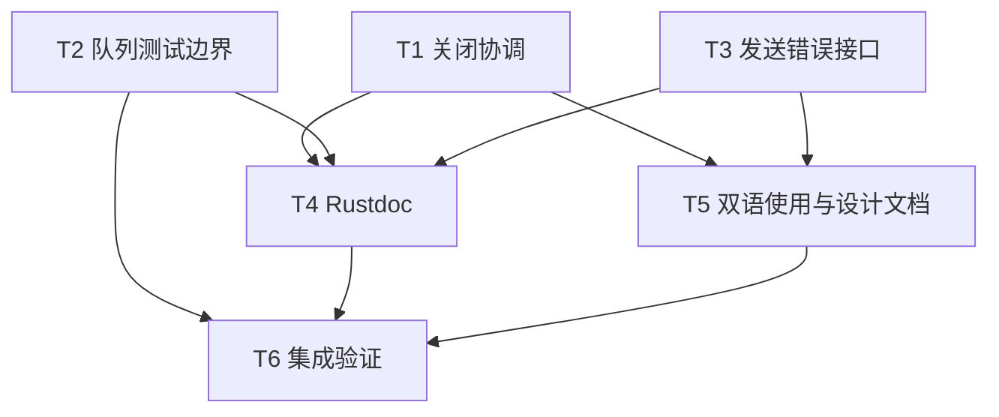

# rs-websocket 关闭协调与文档边界修复实施计划

> **面向执行者：** 依据[本轮设计](design-20261014T021031598Z-49c7bedd.md)实施，用 `- [ ]` 跟踪进度。设计和计划已获用户授权直接产出；本文不表示代码已经修改。实施时遵守当时有效的仓库规则及用户授权。

**目标：** 消除关闭假成功及对端关闭码丢失的调度窗口，完善 `WsSendError`、队列测试边界、Rustdoc 与双语使用及设计文档。

**架构：** 关闭请求先于队列关闭；写任务不能把队列结束解释为握手成功。驱动在写任务先结束时合并对端 Close 快照，只有观察到对端 Close 且写操作成功才发布 `Closed`。其余公开会话和消息 API 保持原状。

**技术栈：** Rust 2024、Rust 1.94、Tokio 1.53、tokio-tungstenite 0.29、Cargo、项目 `.infra` 检查工具。

**工作目录：** `/data/working/qubit/rust-common/rs-websocket`。用户明确要求方案文件保存在本仓库指定路径，未使用临时设计目录；实施时也不要创建新的 Paseo workspace。

## 全局约束

- 先检查 Git 状态、项目内 `AGENTS.md` 和相关按需规则；保留任何预存用户改动。只处理本设计覆盖的文件。
- 保留 `WsTermination::{Closed, Error}`、`WsSendError` 三个现有变体、`send()` 只确认入队、`receive()` 终态错误只交付一次、关闭期限和 TLS/握手行为。允许必要的破坏性调整，但本方案无需新增破坏性公共 API。
- 生产 Rustdoc 使用英文；双语 README、指南和当前架构摘要语义一致。历史设计文件保留历史属性。
- 先写可控的失败回归，再改生产代码；不得用反复跑概率测试或任意 `sleep` 代替同步门闩。
- 所有 Cargo/样式脚本共享 `target` 资源组，重型命令必须串行，尤其不得将 `.infra/bin/style-check.sh` 与 `cargo test` 并行。
- 不执行 `git add`、`git commit`、`git push`，除非后续用户明确授权。旧 `tests/queue_tests.rs` 仅在四个测试完整迁移、验证通过后删除；这是该任务明确涉及的文件操作。

## 文件职责

| 路径 | 本轮职责 |
| --- | --- |
| `src/session.rs` | 关闭请求与队列关闭的顺序、生命周期 Rustdoc |
| `src/session/driver.rs` | 出站队列意外结束的错误分类、写任务先结束时合并对端码、受控回归 |
| `tests/session_tests.rs` | 公开 API 的关闭握手与重试回归 |
| `src/session/queue.rs`、`tests/queue_tests.rs` | 私有队列测试迁入模块，去除 `#[path]` 重定向 |
| `src/error.rs`、`tests/options_tests.rs` | `WsSendError` 标准错误接口及安全格式测试 |
| `README.md`、`README.zh_CN.md`、`doc/user_guide.md`、`doc/user_guide.zh_CN.md` | 新错误传播示例、关闭与业务边界、应用处理接口 |
| `doc/architecture.md`、`doc/architecture.zh_CN.md`、`doc/design.zh_CN.md` | 中英文现行架构入口及历史设计导航 |

## 调度图

`T1`、`T2`、`T3` 的写入集合不相交，可在同一批次推进；`T4` 与 `T5` 在其前置产物完成后也可同批推进。并行编辑不代表并行运行共享 `target` 的重型验证。若只有一位执行者，按依赖顺序执行即可。

| 任务 | 前置任务 | 最小解锁产物 | 写入集合 | 本地验证 | 集成验证归属 | 审查时机 |
| --- | --- | --- | --- | --- | --- | --- |
| T1 关闭协调 | 无 | 两条竞态路径有失败回归且修复后通过 | `src/session.rs`、`src/session/driver.rs`、`tests/session_tests.rs` | `cargo test --locked --lib session::driver::tests`；`cargo test --locked --test session_tests` | T6 | 立即审查 |
| T2 队列测试边界 | 无 | 四个旧测试在私有模块通过且旧目标移除 | `src/session/queue.rs`、`tests/queue_tests.rs` | `cargo test --locked --lib session::queue::tests` | T6 | 批量审查 |
| T3 发送错误接口 | 无 | `WsSendError` 可直接经 `?` 传播 | `src/error.rs`、`tests/options_tests.rs` | `cargo test --locked --test options_tests` | T6 | 立即审查 |
| T4 Rustdoc | T1、T2、T3 | 本轮触及的内部状态与核心错误文档准确 | `src/session.rs`、`src/session/driver.rs`、`src/session/queue.rs`、`src/error.rs` | `cargo test --doc --locked` | T6 | 批量审查 |
| T5 双语使用与设计文档 | T1、T3 | 两种语言可沿同一业务场景定位现行契约 | 两份 README、两份用户指南、`doc/architecture.md`、`doc/architecture.zh_CN.md`、`doc/design.zh_CN.md` | 链接/代码符号核对；示例组合编译 | T6 | 批量审查 |
| T6 集成验证 | T2、T4、T5 | 全部门禁、diff 和残留路径检查完成 | 原则上不写；失败退回对应任务 | 格式、样式、全量测试、Clippy、Rustdoc、diff | T6 | 立即审查 |



### T1：建立关闭成功的真实条件

**文件：** `src/session.rs`、`src/session/driver.rs`、`tests/session_tests.rs`。

**接口：** 公开 `close() -> Result<(), WsError>` 和 `termination() -> Option<WsTermination>` 签名不变。私有合并函数改为 `resolve_termination(read: ReadResult, write: Option<WsErrorKind>, peer: Option<Option<u16>>) -> WsTermination`，写任务先结束的分支使用 `finish_after_writer(write: Option<WsErrorKind>, peer: &watch::Receiver<Option<Option<u16>>>) -> WsTermination` 读取快照并转发给合并函数。`peer` 的外层 `Option` 表示是否观察到 Close，内层 `Option<u16>` 是 Close 帧可能缺省的状态码。`complete_after_reader` 同步接收对端 Close 观察者。

- [x] 在 `src/session/driver.rs` 先添加受控测试：构造空 `BoundedQueue`、没有关闭请求的 `watch` 通道和现有 `ControlledSink`，关闭队列后运行 `write_loop`，断言结果为 `Some(WsErrorKind::Internal)`；当前实现会返回 `None`，因此先确认测试为红。
- [x] 扩展 `resolve_termination` 表格测试，对 `ReadResult::LocalClose` 分别断言 `(None, Some(Some(1000))) -> Closed(1000)`、`(None, Some(Some(1009))) -> Closed(1009)`、`(None, Some(None)) -> Closed(None)`、`(None, None) -> Error(Internal)`、`(Some(Transport), Some(Some(1000))) -> Error(Transport)`；保留 `ReadResult::Closed` 原码与读侧错误优先级断言。原来的 `LocalClose + None -> Closed(None)` 断言必须改为只有确实观察到无状态码 Close 才成立。
- [x] 在 `tests/session_tests.rs` 增加多线程关闭测试（`#[tokio::test(flavor = "multi_thread", worker_threads = 2)]`）：服务端通过 oneshot 门闩报告收到 Close，待门闩确认后才回送 Close；客户端 `close().await` 成功时断言该报告已发生。用信号同步，不依赖睡眠。保留现有关闭超时与取消后重试测试。
- [x] 在 `src/session.rs::close()` 把 `self.owner.close.send(Some(CloseRequest::Local))` 移到 `self.owner.outbound.close()` 之前，两步之间不 `await`；不改变 `Owner::drop()` 已有的请求优先顺序。
- [x] 在 `write_loop` 的 `outbound.pop()` 分支，将 `None` 明确映射成 `Some(WsErrorKind::Internal)`，而不是通过 `outgoing?` 映射成成功。其余 `SendResult` 与慢消费者关闭路径维持原分类。
- [x] 在 `run_parts` 创建 `peer_closed_rx` 后保留其只读 clone；写任务先结束时调用 `finish_after_writer(write_result, &peer_observer)`，然后中止读任务。读任务先结束时，`complete_after_reader` 在写任务完成后读取同一快照并传入合并函数。读侧错误优先级保持现状；写失败必须覆盖已观察到的对端码，成功且无对端 Close 必须成为 `Internal`。

  合并函数应按以下穷尽规则实现；`finish_after_writer` 传入 `ReadResult::LocalClose` 和 `*peer.borrow()`：

  ```rust
  match (read, write, peer) {
      (ReadResult::Error(kind), _, _) => WsTermination::Error { kind },
      (_, Some(kind), _) => WsTermination::Error { kind },
      (ReadResult::Closed(code), None, _) => WsTermination::Closed { code },
      (ReadResult::LocalClose, None, Some(code)) => WsTermination::Closed { code },
      (ReadResult::LocalClose, None, None) => WsTermination::Error {
          kind: WsErrorKind::Internal,
      },
  }
  ```

- [x] 用 `watch::channel(None::<Option<u16>>)` 对 `finish_after_writer` 做受控测试：发送 `Some(Some(1009))` 后直接调用该实际分支 helper，断言保留 `1009`；对未发送 Close 断言 `Internal`。保留现有受控 `run_parts` 写失败测试，并在公开会话测试中断言对端 `1009` 仍可见；不以概率调度断言某个 `tokio::select!` 分支必先完成。
- [x] 顺序运行 `cargo test --locked --lib session::driver::tests`、`cargo test --locked --test session_tests`；预期全部通过。检查代码中 `Closed` 的每条生成路径都满足“对端 Close 已观察 + 必需写操作成功”。

### T2：恢复队列测试的私有边界

**文件：** `src/session/queue.rs`、`tests/queue_tests.rs`。

- [x] 在 `src/session/queue.rs` 新增 `#[cfg(test)] mod tests`，将旧文件的四个测试及 `text(&str) -> WsMessage` helper 搬入，直接 `use super::BoundedQueue`，并导入 `WsMessage`、`WsSendError`、`Duration` 与 `tokio::time::timeout`。保留计数、字节、取消释放 permit、关闭唤醒和 32 轮交错断言；只调整访问路径和测试名，使私有测试以 `test_*` 命名。
- [x] 运行 `cargo test --locked --lib session::queue::tests`，预期四个迁入测试通过；核对 `tests/queue_tests.rs` 的四个行为均已在新位置出现，然后删除该旧文件。不得通过扩大 `BoundedQueue` 可见性来满足测试。
- [x] 再运行 `cargo test --locked --test session_tests`，确认公共会话的队列背压路径仍有独立覆盖；检查 `rg -n '#\[path\s*=' tests src` 不再发现本轮队列重定向。

### T3：让发送错误可直接传播

**文件：** `src/error.rs`、`tests/options_tests.rs`。

- [x] 先在 `tests/options_tests.rs` 增加编译型用例：一个返回 `Result<(), Box<dyn std::error::Error + Send + Sync>>` 的函数对 `Err::<(), WsSendError>(WsSendError::Backpressure)?` 直接传播；当前缺少 `Error` 实现，应先编译失败。另对三个变体断言固定的 `Display` 文本不含消息、URL 或凭据。
- [x] 在 `src/error.rs` 为 `WsSendError` 添加 `#[must_use]`、`impl fmt::Display` 和 `impl Error`。三个文本固定为 `WebSocket send queue is full`、`WebSocket session is closed`、`WebSocket message exceeds the outbound limit`；不引入可由对端或应用控制的字符串。
- [x] 运行 `cargo test --locked --test options_tests`，预期测试通过；确认 `WsError` 的脱敏 `Display`/`Debug` 与 source 语义未变，三种发送失败仍能用现有 `Eq` 断言区分。

### T4：补齐本轮相关 Rustdoc

**前置：** T1、T2、T3 的代码和聚焦测试均已稳定。**文件：** `src/session.rs`、`src/session/driver.rs`、`src/session/queue.rs`、`src/error.rs`。

- [x] 在 `Owner`、`CapacityLimits`、本轮触及的字段、关闭结果 helper 及队列结束路径补英文 Rustdoc，分别说明所有权、通知顺序、`Option<Option<u16>>` 的两层含义和 `Internal` 的触发条件；把仍以普通 `//` 充当 item 说明的相关注释改成紧邻 item 的 `///`。
- [x] 核对 `WsError`、`WsSendError` 的类型级示例及 `# Errors`/返回值说明；示例经 `qubit_websocket::` 公共路径构造、匹配并处理结果，不写需要真实公网端点才能完成的运行型 doctest。
- [x] 运行 `cargo test --doc --locked`，预期 doctest 全部通过；人工核对 `close()` 和 `termination()` 文档中的成功条件与 T1 实现一致，不把 `Closed(None)` 说成业务完成。

### T5：同步双语用法与现行设计入口

**前置：** T1、T3 的公开行为已固定。**文件：** `README.md`、`README.zh_CN.md`、`doc/user_guide.md`、`doc/user_guide.zh_CN.md`、`doc/architecture.md`、`doc/architecture.zh_CN.md`、`doc/design.zh_CN.md`。

- [x] 更新两份 README 中的发送示例：在返回 `Box<dyn Error + Send + Sync>` 的完整调用链中使用 `session.send(message).await?`，并说明 `WsSendError` 仍有三个可供应用分支处理的变体。保留入队、协议关闭、业务确认三个不同阶段；核对六徽章、语言切换及固定尾部章节。
- [x] 更新两份用户指南的 worker 场景：在事件接收处定义并调用应用提供的处理接口，例如 `handle_job_event(&str) -> Result<(), AppError>`，明确该函数由应用实现，示例中的业务确认只在处理成功后发生；分别给出处理失败、`1009`、缺少状态码、发送背压的后续决策。对于可运行的基础路径，把所需定义组合成可编译代码，不能留下未声明的业务类型。
- [x] 新增 `doc/architecture.md` 与 `doc/architecture.zh_CN.md`，用当前代码说明握手、双向有界队列、Ping/Pong、Close 请求和对端确认、终态发布、发送错误与应用恢复边界；链接本设计及历史 `doc/design.zh_CN.md`。两版独立成文，事实与限制对应。
- [x] 在历史 `doc/design.zh_CN.md` 的顶部指向两份当前架构摘要，在两份 README 的延伸阅读处分别链接对应语言的当前摘要。不要改写历史正文为当前 API，也不要把本待实施设计称作已实现。
- [x] 检查上述 Markdown 的相对链接和代码标识符；把 README/指南的完整示例按文中模块布局组合，在可丢弃的仓库外验证项目中执行 `cargo check --locked`。记录实际命令及退出码；示例若依赖应用实现的接口，验证项目提供清楚标记的最小实现。

### T6：最终集成验证和范围检查

**前置：** T2、T4、T5 完成。**写入：** 原则上不写；发现失败回到所属任务修正。

- [x] 串行运行 `cargo fmt --all -- --check --config-path .infra/style/rustfmt.toml`、`./.infra/bin/style-check.sh`、`cargo test --locked`、`cargo clippy --locked --all-targets -- -D warnings`、`cargo doc --locked --no-deps`；记录每项退出码和实际测试数量。若项目格式检查要求修正，只整理本轮相关文件并重新检查 diff。
- [x] 复核确定性关闭测试、对端码测试、队列迁移测试、`WsSendError` 转换测试、现有 WS/WSS 与 `rs-web` 互通测试均在全量结果中出现；不得仅凭覆盖率百分比判定关闭竞态已修复。
- [x] 执行 `git diff --check`、`git status --short`、`git diff --stat`，逐项核对写入集合及旧队列测试的搬迁，不提交或推送。若目标路径之外出现变更，先确定来源及影响，再决定是否属于本计划。
- [x] 最终报告说明是否确认两条竞态均有可控回归、`Closed` 的成立条件、公共错误接口变化、双语文档状态、全部门禁和未验证项。

## 设计覆盖自检

| 设计要求 | 对应任务 |
| --- | --- |
| 本地关闭不能因队列结束而假成功 | T1、T6 |
| 写任务先结束时保留已观察到的对端码；写失败仍为错误 | T1、T6 |
| 关闭期限、取消重试、单次错误与既有互通不倒退 | T1、T6 |
| `WsSendError` 可安全显示并通过 `?` 传播 | T3、T5、T6 |
| 私有队列测试迁入正常模块边界 | T2、T6 |
| 相关 Rustdoc、双语 README/指南及双语现行设计入口 | T4、T5、T6 |
