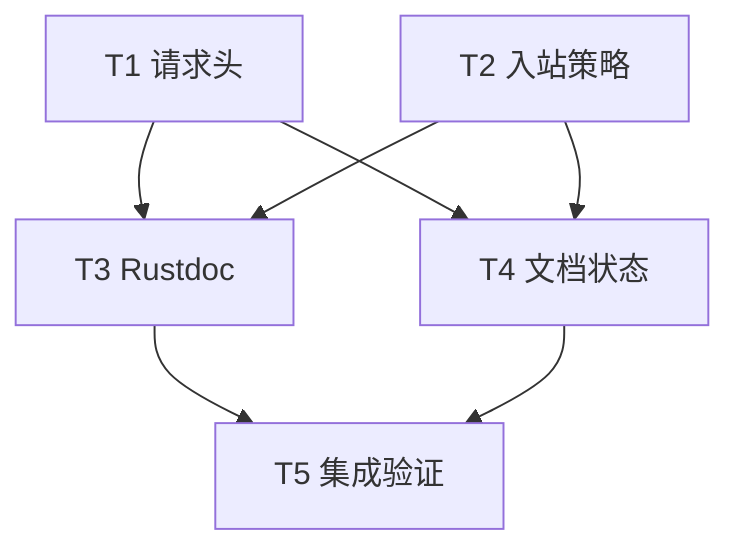

# rs-websocket 请求头、入站背压与文档契约修复实施计划

> **面向智能体执行者：** 按任务依赖逐项实施，以 `- [x]` 跟踪完成状态。用户已经接受[设计文档](design-20261014T043823504Z-0ceb2c88.md)中的全部意见，无需再请求设计审批。实施应在当前 Paseo workspace 的目标项目内进行，不创建新的 Paseo workspace；未经用户另行明确要求，不执行 `git add`、`git commit` 或 `git push`。

**目标：** 保留同名多值握手请求头，明确和验证入站慢消费者策略，并修正 Rustdoc 与双语文档中的误导或过期表述。

**架构：** 不改变现有 `WsClient`、`WsSession` 和驱动分层。请求头在构造握手请求时按名称整组覆盖；入站队列保持一条等待入队消息的上界及控制帧活性，文档明确额外业务消息与无进展期限两条关闭路径。

**技术栈：** Rust 2024、Rust 1.94、Tokio、`http::HeaderMap`、`tokio-tungstenite`、`qubit-web` 本地互通测试。

**执行位置：** `/data/working/qubit/rust-common/rs-websocket`。本计划和设计已按用户指定路径写入 `doc/`，不使用临时文档工作区。

## 全局约束

- 仅修改本计划列出的直接相关文件；允许必要的破坏性变更，但此设计不要求公开 API 变更。
- 默认头与单次连接头均保留自身的同名多值；单次连接头按名称整组覆盖默认头。协议保留头继续拒绝。
- 入站队列满且下一条消息等待入队时继续处理控制帧；再收到业务数据可立即触发慢消费者关闭，无额外业务数据时受 `no_progress_timeout` 约束。
- `send` 成功只证明入队；`Closed { code }` 和 `close() == Ok(())` 只证明协议关闭，均不证明业务完成。
- Rustdoc 生产内容使用英文；README、用户指南和架构说明的中英文版本保持语义一致。
- 共享 `target` 的 Cargo 重型命令由执行者协调串行运行；不启动或修改其他 Paseo workspace。

## 文件与任务边界

| 文件 | 责任 |
| --- | --- |
| `src/client.rs`、`src/client/handshake.rs`、`tests/protocol_tests.rs` | 头合并实现、内部映射回归和真实握手回归。 |
| `src/session/driver.rs`、`doc/user_guide.md`、`doc/user_guide.zh_CN.md` | 入站提前关闭的确定性测试与双语用法说明。 |
| `src/lib.rs`、`src/session/queue.rs` | 本轮触及的 Rustdoc 与私有 helper 说明；`client.rs`、`driver.rs` 的 Rustdoc 在各自任务内完成。 |
| `README.md`、`README.zh_CN.md`、`doc/architecture.md`、`doc/architecture.zh_CN.md`、`doc/design-20261014T021031598Z-49c7bedd.md` | 双语入口与历史设计状态。 |

## 调度图（必填）

| 任务 | 前置任务 | 最小解锁产物 | 写入集合 | 本地验证 | 集成验证归属 | 审查时机 |
| --- | --- | --- | --- | --- | --- | --- |
| T1 请求头 | 无；与 T2 同一并行批次 | `apply_user_headers` 保留多值且覆盖规则有测试 | `src/client.rs`、`src/client/handshake.rs`、`tests/protocol_tests.rs` | `cargo test --locked --lib client::handshake::tests`、聚焦协议测试 | T5 | 立即审查 |
| T2 入站策略 | 无；与 T1 同一并行批次 | 确定性 `SlowConsumer` 测试和双语指南 | `src/session/driver.rs`、`doc/user_guide.md`、`doc/user_guide.zh_CN.md` | `cargo test --locked --lib session::driver::tests` | T5 | 立即审查 |
| T3 Rustdoc | T1、T2；与 T4 同一并行批次 | 示例与触及的私有 helper 语义完整 | `src/lib.rs`、`src/session/queue.rs` | `cargo test --locked --doc` | T5 | 批量审查 |
| T4 文档状态 | T1、T2；与 T3 同一并行批次 | 历史设计状态和双语入口正确 | `README.md`、`README.zh_CN.md`、`doc/architecture.md`、`doc/architecture.zh_CN.md`、`doc/design-20261014T021031598Z-49c7bedd.md` | 链接与术语逐项人工核对 | T5 | 批量审查 |
| T5 集成验证 | T3、T4 | 全量验证结果和范围核对 | `doc/design-20261014T043823504Z-0ceb2c88.md`（门禁通过后更新状态）；失败时交回责任任务 | 本节列出的全量门禁 | T5 独占 | 立即审查 |

T1、T2、T3 的 Cargo 命令共用 `target`，属于同一资源组；即使编辑可并行，Cargo 命令也应串行执行。若实施者没有并行任务能力，可按同一依赖顺序串行完成，勿改变任务写入边界。

## 任务拓扑依赖图（必填）



### T1：保留同名多值握手请求头

**文件：** `src/client.rs`、`src/client/handshake.rs`、`tests/protocol_tests.rs`。

**接口：** `apply_user_headers(target: &mut HeaderMap, headers: &HeaderMap) -> Result<(), WsError>` 签名不变。输入来源内同名值全部保留；较后来源的同名整组覆盖先前来源。`build_request` 的默认头、连接级头、受控子协议头顺序不变。

- [x] 在 `src/client/handshake.rs::request_headers_overlay_defaults_and_reject_protocol_owned_fields` 增加失败断言：默认头 `x-tag` 通过两次 `append` 写入 `one`、`two`，构造无连接级覆盖的请求后，`get_all("x-tag")` 依次得到两值；另给默认 `x-tag` 两值、连接级 `x-tag` 两值 `three`、`four`，断言最终只有连接级两值，同时 `x-trace` 默认值保留。使用 `get_all().iter().collect::<Vec<_>>()` 比较完整值集，不能只取 `headers()[name]`。
- [x] 运行 `cargo test --locked --lib client::handshake::tests::request_headers_overlay_defaults_and_reject_protocol_owned_fields`，确认新增多值断言在现有 `insert` 实现下失败，记录失败原因是值丢失。
- [x] 修改 `src/client.rs::apply_user_headers`：先调用现有 `validate_user_headers`；对 `headers.keys()` 中每个名称，执行 `target.remove(name)`，再遍历 `headers.get_all(name)` 并对每值调用 `target.append(name.clone(), value.clone())`。保持 `build_request` 先默认、后连接级、最后子协议头的顺序；在 helper 上补英文 Rustdoc，明确整组覆盖与多值保留。

  ```rust
  validate_user_headers(headers)?;
  for name in headers.keys() {
      target.remove(name);
      for value in headers.get_all(name) {
          target.append(name.clone(), value.clone());
      }
  }
  Ok(())
  ```
- [x] 重跑上述单测，确认多值与保留头断言均通过。检查 `HeaderMap::keys()` 对同名值只枚举一次；若所用 `http` 版本不满足这一前提，改用显式去重的名称集合，仍只对每名清除一次。
- [x] 在 `tests/protocol_tests.rs` 使用现有本地握手服务端模式增加公开 API 测试：客户端默认头含 `x-tag: default-a/default-b`，`connect_with` 提供 `x-tag: once-a/once-b`；服务端读取握手请求并通过 `get_all("x-tag")` 断言只收到 `once-a/once-b`。同时断言不覆盖的另一个默认头仍在。沿用现有本地监听和有界等待，不请求公网端点。
- [x] 串行运行 `cargo test --locked --lib client::handshake::tests` 与新协议测试；核对 `connect_with` 的认证头覆盖和保留头拒绝回归均通过。

### T2：锁定并说明入站慢消费者语义

**文件：** `src/session/driver.rs`、`doc/user_guide.md`、`doc/user_guide.zh_CN.md`。

**接口：** 不改变公开类型或运行时分类。`enqueue_while_polling_control` 在待入队 `push` 受阻时，额外业务消息返回 `EnqueueResult::SlowConsumer`；无额外业务数据则按 `no_progress_timeout` 结束。

- [x] 在 `src/session/driver.rs` 的私有测试模块新增确定性用例：创建容量为一条消息的 `BoundedQueue`，先填满；将 `futures_util::stream::iter([Ok(Message::Text("extra".into()))])` 作为输入，调用 `enqueue_while_polling_control` 排入另一条消息，设置明显更长的 `no_progress_timeout`；断言立即得到 `SlowConsumer`，不依赖睡眠或线程竞争。若测试只因 stream EOF 分类失败，先核对 helper 的 `tokio::select!` 分支和输入顺序，再修正夹具，使一次业务消息可观察。

  ```rust
  let inbound = BoundedQueue::new(1, 8);
  inbound.try_push(WsMessage::Text("full".into())).unwrap();
  let mut stream = futures_util::stream::iter([Ok(Message::Text("extra".into()))]);
  let (close_tx, mut close_rx) = watch::channel(None);
  let ping = Notify::new();
  let result = enqueue_while_polling_control(
      &mut stream,
      inbound,
      WsMessage::Text("waiting".into()),
      &mut close_rx,
      &ping,
      Duration::from_secs(30),
      CapacityLimits::default(),
  ).await;
  assert!(matches!(result, EnqueueResult::SlowConsumer));
  drop(close_tx);
  ```
- [x] 运行 `cargo test --locked --lib session::driver::tests`，确认新用例和现有控制帧、写入、关闭用例通过。无需为了使既有行为先红而故意改动生产代码；该测试锁定现有但此前未明确验证的分支。
- [x] 在 `src/session/driver.rs` 给 `EnqueueResult`、各非显然变体和 `enqueue_while_polling_control` 补英文 Rustdoc：说明最多一条等待入队业务消息、继续 poll 控制帧、额外业务数据立即 `SlowConsumer`、等待期限到期也 `SlowConsumer`、网络失败的不同结果。只改语义说明，不改动读写调度。
- [x] 在两份用户指南的预算与背压段落，明确“容量恢复即可入队；额外业务数据可提前触发 `1013`；没有额外业务数据时 `no_progress_timeout` 到期也触发；写入失败时不保证对端看到 Close”。在错误排障段落说明此处公开 `Timeout` 对应慢消费者路径，而非业务处理已完成或 Close 已获对端确认。保持英文和中文案例的条件一致。
- [x] 对照现有 `src/session.rs::full_inbound_queue_keeps_control_frames_live_then_closes_with_1013` 与 `tests/session_tests.rs::inbound_full_queue_times_out_with_1013_after_control_frame_progress`，确认至少一条仍验证 Ping/Pong 活性、`1013` 和 `Timeout` 终态；不写与其重复的第三条端到端测试。

### T3：修正公开示例并核对触及的私有 Rustdoc

**前置：** T1、T2 已稳定。**文件：** `src/lib.rs`、`src/session/queue.rs`；`client.rs` 与 `driver.rs` 的相关 Rustdoc 已由 T1、T2 各自完成。

- [x] 将 `src/lib.rs` 类型级示例中 `Closed { code: Some(1000) }` 的输出改为“protocol close completed (1000)”一类只说明协议状态的文字，并在示例下加一句英文说明：业务订阅完成必须依据应用协议中的确认或持久化结果判定。
- [x] 逐项核对 T1、T2 触及的生产私有项：`apply_user_headers`、`EnqueueResult`、`enqueue_while_polling_control` 及其相关变体有解释目的与关键约束的英文 Rustdoc。检查 `src/session/queue.rs::acquire_message`、`acquire_bytes`、`enqueue`、`capacity_error` 等排队 helper；缺失时补说明 permit 所有权、取消和关闭结果。避免只写“returns X”式同义反复。
- [x] 运行 `cargo test --locked --doc`，预期所有 doctest 通过；人工确认 `src/lib.rs` 示例、`receive()`、`close()` 和 `termination()` 的文案均未把入队或关闭码等同于业务成功。

### T4：整理双语入口与历史设计状态

**前置：** T1、T2 的行为已明确。**文件：** `README.md`、`README.zh_CN.md`、`doc/architecture.md`、`doc/architecture.zh_CN.md`、`doc/design-20261014T021031598Z-49c7bedd.md`。

- [x] 在两份 README 的请求头能力或连接用法处加对应说明：同一 `HeaderMap` 可有多个同名值；连接级头以完整同名值组覆盖默认头；协议保留头仍由库管理。核对两种语言的 API 名、`1013`、`Timeout`、`1000` 和业务确认边界，不重复现有能力/限制清单。
- [x] 将旧关闭协调设计文档顶部“待实施方案”改为“已实施的历史设计记录”，在旧测试数字前注明它们是该文档撰写时的快照，不代表当前测试数量。保留旧设计正文中的方案选择与实施背景，避免把历史推理改写成最新行为规范。
- [x] 更新中英文架构文档及两份 README 的延伸阅读标签：`architecture*.md` 是当前架构入口，旧关闭协调文档是已实施历史记录，本设计文档在实现完成前是本轮修复方案。完成实现后将本设计顶部状态从“待实施”改为“已实施”，并同步检查链接标签；不提前宣称尚未完成的代码已发布。
- [x] 人工逐个打开本轮新增与修改的相对 Markdown 链接，核对中英文 README、指南、架构文档对于头覆盖、背压、关闭和历史状态的事实一致。保留既有用户场景和语言切换入口。

### T5：集成验证与交付范围核对

**前置：** T3、T4 完成。**写入：** 所有门禁通过后更新 `doc/design-20261014T043823504Z-0ceb2c88.md` 的状态；失败时回到对应任务修正。

- [x] 串行运行 `cargo fmt --all -- --check --config-path .infra/style/rustfmt.toml`、`./.infra/bin/style-check.sh`、`cargo test --locked`、`cargo clippy --all-targets --locked -- -D warnings`、`cargo doc --locked --no-deps`；记录各命令退出码与实际测试数量。不要用默认 rustfmt 配置的结果代替项目指定配置。
- [x] 复核新增头合并单测与实际握手测试、提前 `SlowConsumer` 私有测试、既有 Ping/Pong、`1013`、WS/WSS、关闭协调和 `qubit-web` 互通测试均出现在全量结果中。若有失败，按实际根因回到 T1 或 T2 修复，再重新跑受影响的聚焦测试和完整门禁。
- [x] 运行 `git diff --check`、`git status --short`、`git diff --stat`。检查改动只涉及本计划写入集合和本设计文档的完成状态；特别确认没有借格式化重排无关文件，也没有移动或删除源码。
- [x] 仅当上述验证全部通过后，将本轮设计文档顶部状态由“待实施”改为“已实施”，并注明验证日期及命令。复核 README 和架构文档对本轮设计的标签没有提前或滞后。
- [x] 最终汇报请求头覆盖规则、入站关闭策略、文档状态和所有门禁的真实结果。保留未验证的风险说明；不执行 `git add`、`git commit` 或 `git push`。

## 设计覆盖自检

| 设计必须项 | 对应任务 |
| --- | --- |
| 默认与连接级头的整组覆盖、多值保留、保留头拒绝 | T1、T5 |
| 入站控制帧活性、额外业务数据提前关闭、期限关闭、`1013`/`Timeout` | T2、T5 |
| `1000` 不推断订阅完成，相关私有 helper 文档化 | T1、T2、T3 |
| 双语 README/指南/架构语义一致，旧设计状态准确 | T2、T4、T5 |
| 项目格式、样式、测试、Clippy、Rustdoc 和改动范围验证 | T5 |
