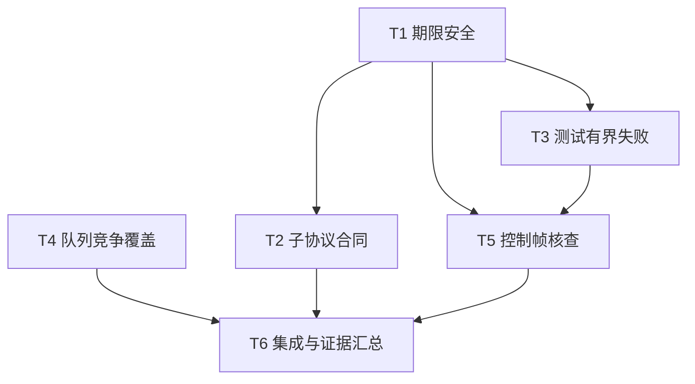

# rs-websocket 期限安全、子协议契约与测试可靠性实施计划

> 面向执行者：逐项跟踪复选框；按未来实施命令授权执行。可使用 executing-plans 分批实施。本文不要求新增 Paseo workspace，不把提交当作任务解锁条件。

**目标：** 完成 WS-001～WS-004 的最小修复，核查 WS-005 并按证据处理。

**架构：** 保留现有客户端、队列和单驱动结构。通过受检期限构造、文档合同对齐及测试同步改进完成目标；不新增公共 API。

**技术栈：** Rust 2024 / MSRV 1.94、Tokio、tokio-tungstenite 0.30、现有本地 WS/WSS 测试与项目 `.infra` 验证入口。

**项目根目录：** `/data/working/qubit/rust-common/rs-websocket`。以下文件和命令均相对此目录。

**设计依据：** [设计文档](design-20261102T032130772Z-60de9f7d.md)。基线 `2e5f3553175841ae248f8fca0c77cd45ca35789f`；执行前核对实际内容，行号只用于定位。

## 采纳范围与持续要求

| 评审编号 | 采纳内容 | 任务映射 |
| --- | --- | --- |
| WS-001 | 超大 Duration 的校验和运行期防溢出 | T1、T6 |
| WS-002 | 子协议协商的双语文档／Rustdoc／测试合同 | T2、T6 |
| WS-003 | Close 等待和接收竞态测试有界失败 | T3、T6 |
| WS-004 | 容量归还与关闭的真实并发测试 | T4、T6 |
| WS-005 | 先核查，确认后才修复期限分支优先级 | T5、T6 |

没有用户明确搁置或拒绝的条目。不能把 WS-005 当作已确认的生产缺陷；无法核查时需记录未完成状态。

持续要求：仅修改任务直接相关内容；CI 仅验证当前 crate，不加入或保留 downstream all-features；在当前 Paseo workspace 中开展工作。文件修改前读取会话 AGENTS.md 按需规则：修复确认缺陷时读 `~/.agents/specs/bug-fix.mdc`；Rust 实现／注释／测试分别读 `rust-coding.mdc`、`rust-comment.mdc`、`rust-test.mdc`。不为了解规则而遍历整个 specs 目录。

当前方案生成阶段的只写文档边界在交付时结束，不是以下实施步骤的限制。代码修改、测试及最终交付按下一阶段实施命令授权处理。

## 调度图

| 任务 | 前置任务 | 最小解锁产物 | 写入集合 | 本地验证 | 集成验证归属 | 审查时机 |
| --- | --- | --- | --- | --- | --- | --- |
| T1 期限安全 | 无 | 开始实施时已核对基线 | options 校验／限额 Rustdoc、session／driver 实现、options／session／driver 私有测试 | 期限相关精确过滤测试 | T6 | 立即审查 |
| T2 子协议合同 | T1 | `ws_session.rs`、options Rustdoc 写入已稳定，T1 聚焦测试通过 | `tests/protocol_tests.rs`、两版指南、session／builder／options 对应 Rustdoc | 子协议成功与失败用例 | T6 | 立即审查 |
| T3 测试有界失败 | T1 | session 私有测试文件已由 T1 释放 | `tests/session_tests.rs`、`src/session/ws_session/ws_session_tests.rs` | helper 负例与原有接收竞态测试 | T6 | 批量审查 |
| T4 队列竞争覆盖 | 无 | 开始实施时已核对基线 | `src/tests/session/internal_tests.rs` | 两种顺序、多线程竞争与唤醒测试 | T6 | 批量审查 |
| T5 控制帧核查 | T1、T3 | driver 期限改动、公开测试等待 helper 已稳定 | driver 私有测试；确认后才改 driver 选择顺序和公开 session 测试 | 受控流探针、loopback、条件修复回归 | T6 | 立即审查 |
| T6 集成与证据汇总 | T2、T4、T5 | 所有功能／核查任务结束并释放文件 | 两份本轮文档的执行记录，必要的本轮格式修正 | 最终 diff 与范围核对 | 本任务统一负责 | 立即审查 |

T1 与 T4 为同一可并行批次；T2 与 T3 在 T1 后可并行。T5 仅因写入依赖等待 T1、T3，不依赖 T2。表中的“可并行”描述文件调度条件，不要求创建代理或额外工作区；单执行者也可按同一依赖顺序实施。所有 Cargo 命令属于同一 target/cache 资源组，重型命令串行运行。

## 任务拓扑依赖图



## T1：期限校验与运行期安全构造

**文件：** 修改 `src/options/ws_client_options.rs`、`src/options/ws_session_limits.rs`、`src/session/ws_session.rs`、`src/session/internal/driver.rs`；测试写入 `tests/options_tests.rs`、`src/session/ws_session/ws_session_tests.rs`、`src/session/internal/driver/tests.rs`。不更改公开签名。

**接口：** 保留 `validate() -> Result<(), WsError>`、`close() -> Result<(), WsError>` 与驱动现有返回类型；无法表示的期限使用 `InvalidConfig`。输出是后续任务可复用的安全期限行为，不新增公共时间类型。

- [ ] 增加两个公开 builder 回归，分别将 `close_timeout`、`no_progress_timeout` 设为 `Duration::MAX`，检查 `build().err().expect(...).kind() == WsErrorKind::InvalidConfig`。同时检查 `WsClientOptions::validate()`，保留默认值和零值覆盖。测试命名包含 `unrepresentable_session_deadline`。
- [ ] 运行 `cargo test --locked --test options_tests unrepresentable_session_deadline`。修复前预期失败在“构建应拒绝”，不主动调用会 panic 的公开关闭路径来代替构建断言。
- [ ] 在 `validate()` 增加以下逻辑，合并到既有成功条件；按项目规则在顶部 import `Instant`：

```rust
let now = Instant::now();
let deadlines_fit = now.checked_add(limits.close_timeout).is_some()
    && now.checked_add(limits.no_progress_timeout).is_some();
```

- [ ] 用 `rg -n 'Instant::now\(\)\s*\+' src/session` 定位同根因加法。`close()` 在发送请求和关闭队列之前构造期限：

```rust
let deadline = Instant::now()
    .checked_add(self.owner.close_timeout)
    .ok_or_else(|| WsError::new(WsErrorKind::InvalidConfig))?;
```

- [ ] 驱动按设计返回类型处理 `None`：读循环返回 `ReadResult::Error(InvalidConfig)`；发送 envelope 返回 `SendResult::Exit(Some(InvalidConfig))`；关闭 helper 返回 `Some(InvalidConfig)`。在重复设置 `close_deadline` 的四条分支都检查，不能只修入口。
- [ ] 使用现有私有 fixture 构造非法内部状态：`session()` 返回后，在测试专用构造中传入 MAX close timeout；断言 `close()` 返回 `InvalidConfig` 且无 panic，并中止 fixture 的 pending driver。驱动测试分别验证 MAX no-progress、MAX close timeout 的对应错误出口，名称包含 `unrepresentable`。不为测试扩大可见性或新增生产 hook。
- [ ] 补充限额字段和校验方法的英文 Rustdoc：时长须非零且可构造会话期限，不能用 MAX 禁用期限。连接／握手相对 timeout 的行为不顺带修改。
- [ ] 运行 `cargo test --locked --test options_tests` 和 `cargo test --locked --lib unrepresentable`，预期新回归及现有 options 用例通过；立即检查错误传播与资源释放。

## T2：子协议文档与协议回归

**文件：** `tests/protocol_tests.rs`、`doc/user_guide.md`、`doc/user_guide.zh_CN.md`、`src/session/ws_session.rs`、`src/client/ws_client_builder.rs`、`src/options/ws_client_options.rs`。仅触及子协议语义句子。

**接口：** 不改变 `subprotocols(Vec<String>)` 或 `selected_subprotocol() -> Option<&str>`；固定现有 `Handshake` / `Subprotocol` 结果。

- [ ] 为 `ResponseCase` 增加 `MissingSubprotocol`；生成仅省略该头、其他升级字段合法的响应：

```rust
ResponseCase::MissingSubprotocol => format!(
    "HTTP/1.1 101 Switching Protocols\r\nUpgrade: websocket\r\nConnection: Upgrade\r\nSec-WebSocket-Accept: {accept}\r\n\r\n"
),
```

- [ ] 将它加入既有失败矩阵，期望 `WsHandshakeFailure::Subprotocol` 和 `WsErrorKind::Handshake`。增加 `test_subprotocol_none_without_offer`，用无提议客户端与未选择子协议的合法服务器握手，检查成功 session 返回 `None` 并有界关闭。
- [ ] 运行 `cargo test --locked --test protocol_tests test_rejects_non_success_and_malformed_handshakes_by_category` 及 `cargo test --locked --test protocol_tests subprotocol`。本项固定既有合同，新测试在改文档前即可通过，不制造虚假的“修复前红灯”。
- [ ] 将双语指南改为：非空提议后服务端必须选中一个提议值，否则连接失败；成功后的 `None` 适用于没有提议的情况。排障表应先检查握手错误，不能要求从失败连接取得 session。
- [ ] 同步 accessor 与 builder／options 的对应英文 Rustdoc。README 仅在确实存在相同错误承诺时改对应句子，不做结构重写；不引入可选协商 API。
- [ ] 自审两版表述及测试矩阵一致，精确成功与失败用例通过后立即审查。文档编译由 T6 统一负责。

## T3：测试失败路径有界

**文件：** `tests/session_tests.rs`、`src/session/ws_session/ws_session_tests.rs`。只使用测试内部 helper 和现有 hook。

**接口：** 在公开 session 测试文件增加本地 `peer_close<S>(&mut WebSocketStream<S>) -> impl Future<Output = Result<(), PeerReadError>>`，泛型约束沿用 `peer_message`；到期由外层一次 `timeout(DEADLINE, ...)` 明确失败。helper 不自动 flush。

- [ ] 先给 Close helper 的 EOF、读取错误及无关帧／静默场景建负例，复用现有 `WS_PEER_EOF_PROBE` 父子测试进程结构，但使用独立环境变量，避免递归执行其他测试。父进程截止后 kill 并收集退出状态，确保错误实现也能结束。
- [ ] 实现 helper 的核心流程，并将一次期限放在整个循环外：

```rust
let wait = async {
    loop {
        match peer_message(websocket).await? {
            Message::Close(_) => return Ok(()),
            _ => {}
        }
    }
};
time::timeout(DEADLINE, wait).await.expect("peer Close deadline")
```

- [ ] 替换评审指出的 Close 等待循环及同文件其他同根因循环。保留原测试的 flush、故意不回复、释放通道顺序；已有正确处理 EOF 的循环不机械替换。
- [ ] 将接收竞态测试里的 `Barrier` 双会合替换为两个通道。hook 发送 checkpoint 后用 `recv_timeout` 等待 release；发布线程用 `recv_timeout` 等待 checkpoint，完成消息／终态发布后发送 release。超时或断连要报出 checkpoint 名称，双方均能退出。
- [ ] 发布线程另发完成信号；只有确认线程已完成后才 join，失败路径不无界 join。以测试局部 guard 保证 hook 清理和 fixture driver abort。保留“最后消息先于终态”“注册通知前后发布终态”“错误仅一次”等原断言。
- [ ] 增加握手对端提前退出和缺失 checkpoint 的负例，验证在总保护期内失败，不能仅验证成功会合。
- [ ] 运行 `cargo test --locked --test session_tests peer_close`、`cargo test --locked --test session_tests test_peer_message_fails_promptly_on_eof`、`cargo test --locked --lib test_receive_`；再运行受替换影响的原关闭测试。预期负例作为测试成功地观察预期失败结果，测试进程正常退出。

## T4：关闭与容量归还的并发覆盖

**文件：** `src/tests/session/internal_tests.rs`。无生产修改。

**接口：** 使用现有 `BoundedQueue::{try_push,try_pop,close,usage}` 和内部 envelope 所有权，不创建新队列 API。

- [ ] 增加两个明确顺序的测试：pop 保留 reservation 后先 close 再 drop；先 drop 再 close。两者均断言容量清零、新 push 为 Closed。
- [ ] 竞争测试改用 `#[tokio::test(flavor = "multi_thread", worker_threads = 2)]`。两个任务持有各自资源，等待同一个异步屏障后分别执行 `queue.close()` 与 `drop(envelope)`；主测试负责等待，不阻塞 runtime worker 的同步屏障。
- [ ] 在起跑前复用同文件 `poll_fn`／oneshot 模式，确认至少两个 blocked pushers 已真正 Pending。竞争结束后检查每个等待者有界结束，结果允许 `Ok(())`（容量先释放且关闭前合法入队）或 `Err(Closed)`，不接受其他结果；关闭会清理已入队消息，最后 `queue.usage() == (0, 0)`。另在确定性先关闭场景要求所有等待者均返回 Closed，避免给真实竞争写入错误断言。
- [ ] 对竞争场景做固定有限轮次采样，例如 32 轮；不给结果设置吞吐或耗时阈值，不声称有限采样穷尽交错。每轮握手和任务 join 各有截止。
- [ ] 运行 `cargo test --locked --lib test_close_and_reservation_drop` 及新增顺序测试的精确过滤；预期全部断言通过。原竞争测试不足属于覆盖增强，不要求生产代码先失败。

## T5：控制帧与等待期限核查及条件修复

**文件：** 必改 `src/session/internal/driver/tests.rs`；仅在确认后改 `src/session/internal/driver.rs`，必要时在 `tests/session_tests.rs` 增加真实 socket 回归。依赖 T1、T3 的稳定文件和测试等待 helper。

**接口：** 保留 `enqueue_while_polling_control` 与 `EnqueueResult`。核查目标为无容量进展时过期得到 `Stalled`，上层仍报告 `Timeout` 并尝试 `1013`。

- [ ] 建立 `test_control_frames_do_not_extend_inbound_deadline` 探针：队列填满，输入一条待入队消息，控制帧流持续 Ready。记录 poll／控制帧计数；外部 wall-clock 保护到期时让测试流返回可识别错误，最终由父进程硬截止保护。保护期应明显大于业务期限，例如 1 秒保护对 20 毫秒业务期限；断言看结果为 Stalled，不比较精确毫秒数。
- [ ] 在未改生产分支前运行 `cargo test --locked --lib test_control_frames_do_not_extend_inbound_deadline -- --nocapture`，保存实际结果。不得将因保护性 sentinel、进程硬截止或测试 fixture 错误导致的退出误标为业务超时成功。
- [ ] 建立 `test_control_traffic_preserves_inbound_timeout` loopback 核查：确认队列满及 waiting 状态后再持续控制流；并行读取控制回复，限制各任务及整个探针寿命。记录控制输入是否确实持续、终态及对端是否观察 1013。无法确认前提时记录不充分，不把网络缓冲阻塞解释为反证。
- [ ] 若有效受控测试证明 helper 违约，移动 deadline 分支到读取流之前，仍在 push 与 local-close 分支之后：

```rust
// biased select 中只调整相对顺序：
// push -> close.changed() -> deadline -> stream.next()
```

- [ ] 若仅移动分支仍无法通过有效探针，在循环内检查受检绝对 deadline；保持入队成功、本地关闭的既有优先级，并记录额外检查的必要证据。不能仅移除 biased 或增加 sleep 作为修复。
- [ ] 增加／保留容量恢复、额外业务消息 Overflow、Ping/Pong 活性、PeerClose／LocalClose 与期限同时就绪的相关回归。运行 `cargo test --locked --lib inbound_enqueue`、受控探针及 loopback 精确过滤。
- [ ] 按三种结果收束：确认则写根因与红绿证据；未复现则保留有效核查并不改生产；环境阻断则保持未完成核查并报告阻断。受控复现与真实 socket 复现分别记录，不能混称已确认的网络路径。T6 如遇未完成核查，不得宣告五项全部闭环。

## T6：统一验证与交付证据

**文件：** 检查最终所有变更，仅更新本轮设计、计划的执行记录及必要的本轮格式修正。负责全部昂贵集成命令，其他任务不重复执行。

- [ ] 核对 T1～T5 的聚焦证据及 WS-005 分支结论。检查公共签名和错误枚举没有意外变化，文档没有把未验证疑点写成确定缺陷。
- [ ] 运行项目 `./.infra/bin/align-ci.sh`，立即检查 `git diff --stat`、`git diff --check` 和最终 diff。若工具触及无关内容，先辨明来源并无损恢复工具产生的无关格式变化；不得覆盖用户改动。
- [ ] 依次运行 `./.infra/bin/style-check.sh`、`cargo check --locked --workspace --all-targets`、`cargo test --locked`、`cargo test --locked --features config`、`cargo clippy --locked --all-targets --all-features -- -D warnings`、`cargo doc --locked --no-deps --all-features`。当前 features 仅可组合的 config，可使用本 crate 的 all-features。记录实际退出码与测试总数，不复制历史快照。
- [ ] 运行 `./.infra/bin/ci-check.sh`，核对其当前 crate hook 和 feature 覆盖；CI 已执行的昂贵检查不再无理由追加重复运行。若实施时先完成 CI 且能提供以上各项等效命令与 feature 证据，可直接复用对应结果，只补缺项。
- [ ] 核对两版指南、相关 Rustdoc 和文档链接；新计划与新设计保持互链。不得顺带改写历史设计、升级依赖、重建锁文件或增加下游 all-features 矩阵。
- [ ] 在两份文档执行记录中填写各任务修改范围、聚焦及集成命令结果、WS-005 证据性质、平台限制和剩余阻断。默认及 config feature、已有 TLS provider／互通测试失败时先定位，不以“本轮无关”直接宣告完成。

## 完成判据与需求映射

| 必须项 | 对应任务 | 可审查证据 |
| --- | --- | --- |
| MAX 会话超时拒绝且运行期无期限溢出 panic | T1、T6 | builder／内部边界回归、受检加法 diff |
| 子协议指南、Rustdoc 与底座合同一致 | T2、T6 | 非空 offer 缺头失败、无 offer 返回 None、双语文本 |
| Close 等待和 hook 异常路径有界失败 | T3、T6 | EOF／错误／缺失会合负例、父进程截止证据 |
| 两种顺序与跨线程竞争实际覆盖 | T4、T6 | Pending 握手、容量归还与所有等待者唤醒断言 |
| 疑点先核查、修复取决于证据 | T5、T6 | 修复前探针、受控与 socket 分开的结果、条件 diff |
| 不扩大架构、生产下游或 CI 范围 | T6 | 最终 diff、当前 crate CI 结果 |

## 执行记录

本节为后续实施记录位置。当前仅完成方案生成，T1～T6 均未执行；未运行聚焦测试、构建、格式工具或 CI，不预填通过结论。
